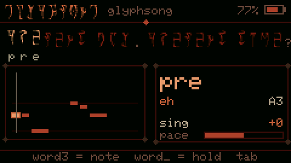
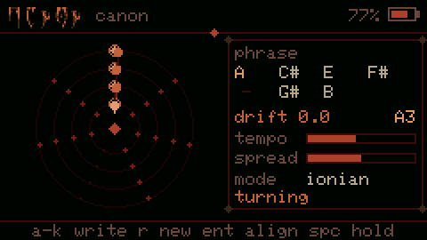
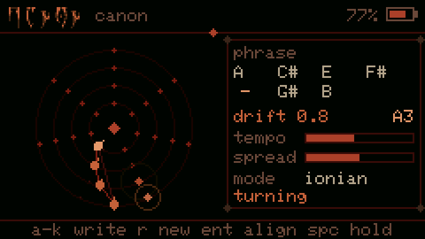
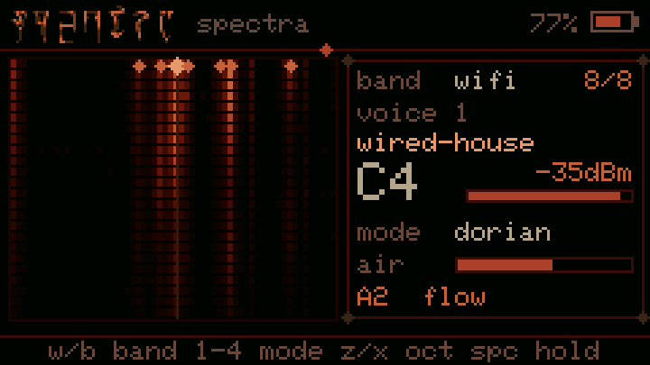
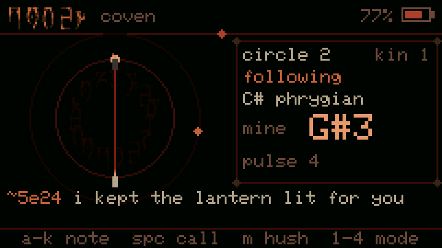
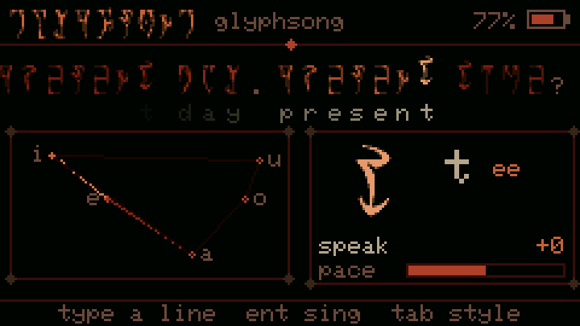
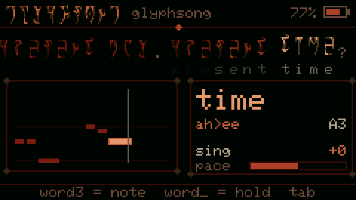

# cardputer-adv-diviner

A Daedric / Lain-core skinned companion firmware for the **M5Stack Cardputer ADV**,
standalone or booted by the [Launcher](https://github.com/bmorcelli/Launcher). Twenty "rites"
across four domains — **sound**, **sight**, **the wired**, and **wards** — in one
blood-and-ember aesthetic, with a hand-rasterised Daedric glyph font.

<p align="center">
  
  
</p>

<p align="center">
  <br>
  <em>Every rite rides the carousel in Daedric script; the one you land on dissolves into plain words.</em>
</p>

> **For authorized use only.** The networked and IR rites inspect and test
> networks and devices **you own or are explicitly permitted to test**. See
> [NOTICE.md](NOTICE.md). This project deliberately does **not** implement
> denial-of-service or phishing attacks.

---

## New in November 2026

<p align="center">
  
  
</p>

- **glyphsong** — type a line and it is sung back in a small formant voice. *Speak*
  is animalese (one chirped syllable per letter; a e i o u sound as themselves),
  *chant* and *choir* hold it over a drone, and **sing** is a tiny UTAU: words are
  split into syllables, each held on a note with real onsets, diphthongs and codas.
- **canon** — tape loops drifting out of phase, after Eno and Reich.
- **spectra** — the Wi-Fi networks (or BLE devices) around you become a choir.
- **coven** — Cardputers share one drone over ESP-NOW; DYAD dongles nearby are
  heard as whispering familiars.
- **drone** — the bell is an FM strike now (lower, and capped at E5), with six
  styles on `p`: temple, tubular, bowl, kalimba, gong, ice.
- Fixes: Wi-Fi scanners no longer stall while an old network is being rejoined;
  rites free their memory on exit; menu letter keys no longer open rites.
  The app is now about 1.66 MB — see [Installing](#installing-on-the-cardputer).

---

## Rites

### ◈ sound
| | | |
|---|---|---|
|  |  |  |
| **drone** — generative drone box: 5 drifting voices, resonant LP, wind, FM bells, dark delay; **6 styles on `p`** (temple, tubular, bowl, kalimba, gong, ice) | **seq** — groovebox: kick/snare/hat/acid, euclid fills, **4 pattern banks + song mode + save/load** | **beat** — bytebeat livecoder: type a C expression in `t`, hear it instantly |
|  |  |  |
| **canon** — one phrase on four tape-loop reels of slightly different lengths, drifting out of phase into endless counterpoint; write your own phrase on the piano row | **spectra** — the air sings: every nearby Wi-Fi AP or BLE device becomes a choir voice (address → note, signal → loudness); arrivals bloom, departures sigh; a waterfall of the air | **coven** — an ESP-NOW circle: every Cardputer running it holds a note of one shared drone, the eldest keeps root and mode, a pulse rings round the seats; DYAD dongles' lines are whispered aloud as familiars |
|  |  | |
| **glyphsong** — type a line and it is sung back in a formant voice: *speak* (animalese — a e i o u as themselves, consonants sing their letter-name vowel), *chant*, *choir*; runes wake into latin as they are voiced, a vowel chart traces the mouth | **glyphsong · sing** — a tiny UTAU: syllables (maximal onset), diphthongs and codas held on notes; the melody writes itself, or `word5` sets a note and `word_` holds; piano roll | |

<details><summary><b>keys for the new rites</b></summary>

| rite | keys |
|---|---|
| drone | `a`–`k` root · `1`–`6` mode · **`p` style** · `z`/`x` octave · arrows light/drift · `n` wind · `b` bells · space hold · `r` reseed |
| canon | `a`–`k` write a note (pause 2.5 s to start a new phrase) · `0` rest · bksp erase · `r` new phrase · `1`–`4` mode · `z`/`x` octave · `;`/`.` tempo · `,`/`/` spread · enter realign · space hold |
| spectra | `w` Wi-Fi · `b` BLE · `1`–`4` mode · `z`/`x` octave · `;`/`.` select voice · `,`/`/` air · space hold |
| glyphsong | type the line · enter sing · bksp erase · tab style (speak/chant/choir/sing) · `Fn`+`;`/`.` pitch · `Fn`+`,`/`/` pace · in *sing*: `word3` = note 3 (1 = root, 8 = octave), `word_` = hold a beat longer |
| coven | `a`–`k` your note · `1`–`4` mode (eldest only) · `z`/`x` octave · space call the circle · `m` hush familiars |

</details>

### ◈ sight
| | | |
|---|---|---|
|  |  |  |
| **wired** — ASCII 3D: torus, navi sphere, wireframe solids, tunnel | **visions** — plasma, Oblivion gate, ash-fire, Daedric glyph-rain, heptagram kaleidoscope | **oracle** — cast three runes with bell chimes |

### ◈ the wired
| | | |
|---|---|---|
|  |  |  |
| **link** — join Wi-Fi (remembers networks); **captive-portal detect + click-through accept**; merges scans so flaky hotspots stick<br>*(2.4GHz only — set phone hotspots to 2.4GHz)* | **scry** — Wi-Fi networks as a constellation | **listen** — receive-only channel monitor you can hear |
|  |  |  |
| **kin** — Bluetooth devices as drifting familiars | **net** — map the LAN: hosts, names, open ports | **gemini** — gemtext browser over TLS (+ posting) |
|  | | |
| **banish** — IR remote: TV power/volume across 5 protocols | | |

### ◈ wards
| | | |
|---|---|---|
|  |  |  |
| **sentinel** — learns a baseline, then alarms on unknown devices; flags likely **drones** | **pulse** — Wi-Fi CSI motion / presence radar (experimental) | **probe** — active HTTP recon + default-credential check on an authorized host |

Everywhere: the top button (G0) or `` ` `` leaves a rite; twice in the menu returns
to the Launcher (or restarts, when installed standalone). Digits `1`–`9` in the
menu jump to the first nine rites. `Fn` + `-`/`=` sets the volume. Menu and list navigation have
Kingdom-Hearts-style sound feedback.

---

## Build

```sh
pio run -e cardputer      # .pio/build/cardputer/firmware.bin (+ firmware.factory.bin, merged)
pio run -e native         # desktop simulator (SDL2), 240x135 at 3x
.pio/build/native/program # laptop keys: arrows = Fn+;./  Alt = Fn  Esc = `
tools/shots.sh shots      # headless screenshots + WAVs of every rite
```

### Running in the simulator

The simulator plays audio through SDL, or to a file with `GRIM_WAV=out.wav`;
`GRIM_SCRIPT` drives it headless (see `src/hal_native.cpp`). A prebuilt device
image is in [`dist/`](dist/).

- Left Ctrl+R / Left Ctrl+L: rotate screen (swap width/height).
- Left Ctrl+1 through Left Ctrl+6: set window scale factor (1x–6x).

These only fire with Left Ctrl alone (no Shift, Right Ctrl, or Num Lock);
every other key goes to the app.

### Installing on the Cardputer

Prebuilt images and full instructions are in [`dist/FLASHING.md`](dist/FLASHING.md).
Back up first: `esptool read-flash 0 0x800000 backup.bin`.

- **Standalone (clean install):** flash `dist/daedric-grimoire-cardputer-adv.bin`
  at `0x0`. To update later, write just the app (`firmware.bin`) at `0x10000`;
  your saved networks and patterns survive.
- **Under the Launcher:** copy `firmware.bin` to the SD card and install it from
  the Launcher, or push it over its USB serial installer, so the Launcher sizes
  the partition. The app is now ~1.66 MB, larger than the old 1600 KB slot:
  don't write it over an existing Launcher slot by offset.

## Development

### Layout
- `src/hal.*` — the hardware seam. `hal_device.cpp`: M5Cardputer, ES8311 codec,
  TCA8418 keyboard, 24 kHz audio with a UI-sfx overlay. `hal_native.cpp`: LovyanGFX
  SDL panel + SDL/WAV audio.
- `src/net.*` — Wi-Fi, BLE, promiscuous sniffing, ESP-NOW, LAN sweep, CSI, Gemini (TLS).
  `net_device.cpp` is real; `net_native.cpp` returns canned data for the sim.
- `src/theme.*`, `src/daedric_glyphs.h`, `src/dsp.h`, `src/uisfx.h` — skin, font,
  DSP kit, UI sounds.
- `src/vox.h` — the formant voice shared by glyphsong and coven: glottal saw
  through three resonant bands, letter- and syllable-level phonetics.
- `src/apps/*.cpp` — one file per rite (`src/rite.h`).

### Working with `clangd`

For editors which rely on `clangd` you may need to generate a `compile_commands.json` to make your LSP happy:

```sh
pio run -e native -t compiledb
```

## Credits & license
MIT — see [LICENSE](LICENSE). Daedric font: **OMW Ayembedt** (SIL OFL 1.1,
`tools/OFL.txt`). Built on M5Cardputer / M5Unified / M5GFX and (for the sim)
LovyanGFX.
