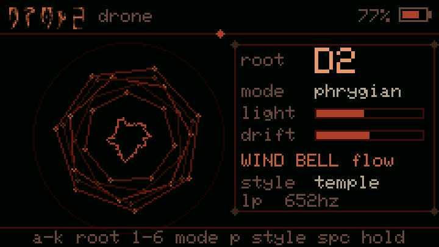

# Diviner

A Daedric / Lain-core skinned companion firmware for the **M5Stack Cardputer ADV**,
booted by the [Launcher](https://github.com/bmorcelli/Launcher). Sixteen "rites"
across four domains — **sound**, **sight**, **the wired**, and **wards** — in one
blood-and-ember aesthetic, with a hand-rasterised Daedric glyph font.
The **ESP32-2432S028R Cheap Yellow Display (CYD)** build runs as standalone
firmware with landscape touch controls and an on-screen keyboard.

<p align="center">
  
  
</p>

<p align="center">
  <br>
  <em>Every rite rides the carousel in Daedric script; the one you land on dissolves into plain words.</em>
</p>

> **For authorized use only.** The networked and IR rites inspect and test
> networks and devices **you own or are explicitly permitted to test**. See
> [NOTICE.md](NOTICE.md). This project deliberately does **not** implement
> denial-of-service or phishing attacks.

---

## Rites

### ◈ sound
| | | |
|---|---|---|
|  |  |  |
| **drone** — generative drone box: 5 drifting voices, resonant LP, wind, bells, dark delay | **seq** — groovebox: kick/snare/hat/acid, euclid fills, **4 pattern banks + song mode + save/load** | **beat** — bytebeat livecoder: type a C expression in `t`, hear it instantly |

### ◈ sight
| | | |
|---|---|---|
|  |  |  |
| **wired** — ASCII 3D: torus, navi sphere, wireframe solids, tunnel | **visions** — plasma, Oblivion gate, ash-fire, Daedric glyph-rain, heptagram kaleidoscope | **oracle** — cast three runes with bell chimes |

### ◈ the wired
| | | |
|---|---|---|
|  |  |  |
| **link** — join Wi-Fi (remembers networks); **captive-portal detect + click-through accept**; merges scans so flaky hotspots stick<br>*(2.4GHz only — set phone hotspots to 2.4GHz)* | **scry** — Wi-Fi networks as a constellation | **listen** — receive-only channel monitor you can hear |
|  |  |  |
| **kin** — Bluetooth devices as drifting familiars | **net** — map the LAN: hosts, names, open ports | **gemini** — gemtext browser over TLS (+ posting) |
|  | | |
| **banish** — IR remote: TV power/volume across 5 protocols | | |

### ◈ wards
| | | |
|---|---|---|
|  |  |  |
| **sentinel** — learns a baseline, then alarms on unknown devices; flags likely **drones** | **pulse** — Wi-Fi CSI motion / presence radar (experimental) | **probe** — active HTTP recon + default-credential check on an authorized host |

Everywhere: the top button (G0) or `` ` `` leaves a rite; twice in the menu returns
to the Launcher. `Fn` + `-`/`=` sets the volume. Menu and list navigation have
Kingdom-Hearts-style sound feedback.

---

## Build

```sh
pio run -e cyd            # ESP32-2432S028R (4 MB flash)
pio run -e cardputer      # .pio/build/cardputer/firmware.bin -> install via the Launcher
pio run -e native         # desktop simulator (SDL2), 240x135 at 3x
.pio/build/native/program # laptop keys: arrows = Fn+;./  Alt = Fn  Esc = `
tools/shots.sh shots      # headless screenshots + WAVs of every rite
```

### Installing on the CYD

The `cyd` target uses an ILI9341 LCD, XPT2046 resistive touch and the GPIO26
speaker amplifier on the ESP32-2432S028R. Use the matching board revision.
Connect the CYD over USB and run the upload command with its serial port.

```sh
pio run -e cyd -t upload --upload-port COM21
pio device monitor -e cyd --port COM21
```

Close the serial monitor before uploading. If the log reports `Wrong boot mode`,
hold **BOOT**, tap **RESET/EN**, and keep holding **BOOT** until the uploader
connects. Diviner starts directly after reset. The images in `dist/` are for
the Cardputer ADV.

Tap the carousel's centre card to open a rite or tap either side to browse.
Each rite has labelled controls below its viewport. **Menu** returns to the
carousel, and the board's **BOOT** button also works as Back while Diviner is
running. Tap steps directly in **seq** and use **More** for tempo and pattern
actions. **beat**, **wifi** and **gemini** use the on-screen keyboard. Audio
requires a speaker attached to the CYD's two-pin speaker connector.

The CYD build includes 14 rites. **Banish** requires an IR emitter, and **Probe**
is excluded from the CYD build. **Pulse** measures CSI from the connected 2.4 GHz
access point and indicates when it is waiting for frames. The Bluetooth scanner
tracks up to 32 recent devices to fit the CYD's memory.

### Streaming CYD audio to VLC on Windows

The `cyd-pcm` firmware sends Diviner’s mixed audio over USB serial as 24 kHz,
16-bit mono PCM at 533,333 baud. The VLC input plugin accepts `cydpcm://COM21` and the CYD's
blue LED lights while it is streaming. Use the CYD volume controls to adjust
the mix before it is sent to VLC.

```powershell
pio run -e cyd-pcm -t upload --upload-port COM21
.\tools\vlc\build.ps1
.\tools\vlc\open.ps1 -Port COM21
```

The build script uses the Windows x64 VLC 3.0.24 SDK. The launcher loads the
plugin into a new VLC instance and sets 150 ms of live caching. Change the
buffer with `-CachingMs` or open another CYD port by changing `-Port`. Use
`-VlcPath` to choose a different VLC executable. To stage a matching portable
copy, run `build.ps1 -StagePortable` and pass
`.pio/vlc-sdk/vlc-3.0.24/vlc.exe` to `-VlcPath`.

Close serial monitors before starting playback because only one program can
open the COM port at a time. Stop playback before flashing or opening a
monitor. To hear the synth, open a sound rite such as **drone** or **seq** on
the CYD.

### Running in the simulator

The simulator plays audio through SDL, or to a file with `GRIM_WAV=out.wav`;
`GRIM_SCRIPT` drives it headless (see `src/hal_native.cpp`). A prebuilt device
image is in [`dist/`](dist/).

- Left Ctrl+R / Left Ctrl+L: rotate screen (swap width/height).
- Left Ctrl+1 through Left Ctrl+6: set window scale factor (1x–6x).

These only fire with Left Ctrl alone (no Shift, Right Ctrl, or Num Lock);
every other key goes to the app.

### Installing on the Cardputer

Copy `firmware.bin` to the SD card and install it from the Launcher, or push it
over USB serial while the Launcher is running (the Launcher grows the app
partition to fit). The ADV is a full wipe from the factory firmware — back up
first with `esptool read-flash 0 0x800000 backup.bin`.

## Development

The `cyd-diagnostics` target enables USB serial bench testing at 115200 baud.
Send `status` for heap, display timing and audio counters, `tap X Y` to inject
a landscape touch, or `shot` to read the LCD as 320×240 little-endian RGB565.

### Layout
- `src/hal.*` — the hardware seam. `hal_device.cpp`: M5Cardputer, ES8311 codec,
  TCA8418 keyboard, 24 kHz audio with a UI-sfx overlay. `hal_cyd.cpp`: LovyanGFX
  LCD, XPT2046 touch, and ESP32 DAC audio. `cyd_controls.cpp` provides the touch
  dock and keyboard. `hal_native.cpp`: LovyanGFX SDL panel + SDL/WAV audio.
- `src/net.*` — Wi-Fi, BLE, promiscuous sniffing, LAN sweep, CSI, Gemini (TLS).
  `net_device.cpp` is real; `net_native.cpp` returns canned data for the sim.
- `src/theme.*`, `src/daedric_glyphs.h`, `src/dsp.h`, `src/uisfx.h` — skin, font,
  DSP kit, UI sounds.
- `src/apps/*.cpp` — one file per rite (`src/rite.h`).

### Working with `clangd`

For editors which rely on `clangd` you may need to generate a `compile_commands.json` to make your LSP happy:

```sh
pio run -e native -t compiledb
```

## Credits & license
MIT — see [LICENSE](LICENSE). Daedric font: **OMW Ayembedt** (SIL OFL 1.1,
`tools/OFL.txt`). Built on M5Cardputer / M5Unified / M5GFX and (for the sim)
LovyanGFX.
