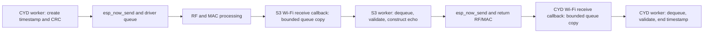

# Separating application RTT from the ESP-NOW radio path

The measured application RTT is **not an ESP-NOW hardware latency floor**.
The approved source `174a79670d4b0da656ebd615f0cd1620aa0ddbb1` records time from
packet creation through remote validation/echo to local validation. It does not
record RF transmission, RF reception, callback arrival, queue residence or MAC
retry durations separately. This read-only audit proposes characterization
experiments; no firmware change or hardware action was performed.

The `link-wifi-02` campaign was still in progress when inspected. The following
six completed 10-second direct ESP-NOW RTT windows are already available in its
`results.json`; later campaign progress does not turn them into radio-only
measurements. All use 64 application payload bytes plus the 40-byte benchmark
header, requested 50 packets/s, channel 6, and queried Wi-Fi power save enum 0
(`WIFI_PS_NONE`) on both nodes.

| Run | CYD workload | RTT samples | Exact mean ms | Exact minimum ms | Exact maximum ms |
|---|---|---:|---:|---:|---:|
| l004_1 | Menu | 478 | 19.474 | 5.011 | 93.019 |
| l005_2 | Menu | 478 | 17.556 | 5.004 | 62.019 |
| l006_3 | Menu | 478 | 17.984 | 4.980 | 78.991 |
| l013_1 | Fullscreen Gate/Trails plus drone | 478 | 12.064 | 5.659 | 36.032 |
| l014_2 | Fullscreen Gate/Trails plus drone | 477 | 12.516 | 5.903 | 86.024 |
| l015_3 | Fullscreen Gate/Trails plus drone | 477 | 12.241 | 5.063 | 46.025 |

Pooled means are 18.338 ms for the menu (1,434 replies) and 12.273 ms for the
fullscreen/drone condition (1,432 replies). Both conditions receive every
API-accepted measurement packet and its reply, with zero reported application
RX callback queue drops or MAC-failure callbacks. Successful MAC delivery does
not count retries. A 32-bin histogram supplies percentile **upper bounds**, not
an exact 60–100 ms percentile. The maxima above are exact observed maxima.

The heavier fullscreen condition has a lower mean in this sequential campaign,
despite higher sampled core-1 busy time. Thus **GUI scheduling is a plausible
contributor, not a demonstrated explanation for the measured mean or tails**.
Channel contention, phase relationships, packet scheduling and different board
workload histories remain potential confounders. The approximately 5 ms best
observations characterize this complete implementation under these conditions;
they do not prove that 5 ms is unavoidable or that a new design will meet it.

## Current path and what it includes

Source locations are `perf_link.cpp`'s `makePacket`, `sendFrame`, `nowReceive`,
`serviceReceive`, `noteReceive`, `receiveOne` and `worker`. The starting timestamp
is written before payload generation and outgoing CRC. The ending timestamp is
taken after incoming header/token/CRC validation. Host serial/USB transport and
the requested wait before the next packet are outside that timestamp interval.
The 500 ms post-window drain allows already-created replies to finish; it is
not an added 500 ms delay on each packet.

Both link workers are pinned to core 1 at priority 1. They try the control mutex
without blocking, process at most eight queued receptions per pass, update
heap observations, and execute `vTaskDelay(1)` after each pass. The pinned
ESP32 and S3 SDK configurations use 1,000 Hz FreeRTOS ticks, so this is a
one-tick delay at a nominal 1 ms tick period, not a fixed 20 ms sleep. Actual
wakeup/run time also depends on scheduling. The CYD Arduino GUI loop is core 1,
priority 1, and performs drawing/SPI work before its frame-cap idle. The S3
standalone loop has no ordinary display or audio worker and delays 1 ms while
idle. Wi-Fi tasks are configured for core 0. Preemption and time slicing are
enabled in the local FreeRTOS headers; equal GUI/link priorities do not by
themselves imply a whole display-frame wait.

The callback copies at most 250 bytes into an eight-entry application queue;
the worker validates and echoes later. The implementation deliberately keeps
that work outside the high-priority Wi-Fi callback. Two such queue waits enter
each RTT. A temporary backlog can fit inside eight entries without a drop, so
zero queue drops does not establish zero queue delay. The eight-operation batch
bound and nonblocking mutex acquisition can defer work until another pass.
During the quiet measurement windows the host issues no setup/info commands,
so long JSON formatting under the control mutex is not an established cause of
these particular tails.

Requested 50 packets/s means at least a nominal 20 ms between newly scheduled
requests. The code polls receive/echo work on every worker pass rather than
waiting for that 20 ms period. Therefore **50 packets/s does not directly add
20 ms to every RTT**. Multiple requests can still be outstanding when RTT
exceeds 20 ms. The module does not wait for each send callback before admitting
the next request. Its pacer schedules the next send from the actual current
time rather than catching up to an absolute periodic grid; `pacing_late` counts
lateness exceeding another full requested period, not every sub-period slip.
The observed 477–478 accepted requests per 10 seconds are below the nominal
500, despite `pacing_late == 0`.

Espressif documents the default ESP-NOW rate as 1 Mbps, callback execution in
the Wi-Fi task, and sending the next packet after the preceding send callback
when avoiding callback disorder. It also distinguishes API admission, MAC
delivery and application receipt. Our image does not configure or export an
actual negotiated PHY rate or per-frame MAC retry count. Driver/MAC queueing,
medium access and retries can contribute time, but their contribution here is
**unmeasured**. See the [pinned IDF ESP-NOW guide](https://docs.espressif.com/projects/esp-idf/en/v4.4.7/esp32/api-reference/network/esp_now.html).

The high-rate one-way windows provide a separate clue, not an attribution:
menu requests at 200 payload bytes and 200 packets/s have 1,698–1,712 attempts
but only 644–855 API admissions; fullscreen/drone has 1,669–1,682 attempts and
1,260–1,300 admissions. Every admitted packet is observed at the peer in those
windows. The rejected sends are visible in `send_errors`, but the current
ESP-NOW wrapper reduces each return code to a boolean, so their exact reason is
unknown (`last_error == 0` does not erase those rejected sends). This supports
testing admission/backpressure separately from over-air loss. It does not
establish a raw RF throughput ceiling.

## Experiments possible with the already-flashed images

These controls exist; the table does not claim the experiments have run.
Keep explicit peer allowlisting/private tokens, identical board placement,
quiet UART windows, source/image identity, CPU/audio/I2S records and actual
accepted counts. Rotate condition order and repeat instead of attributing a
single sequential change to one factor.

| Variable | Existing firmware control | What it can resolve |
|---|---|---|
| Offered packet rate | `perf link arm espnow rtt 64 PPS`, e.g. 10, 25, 50, 100 | Whether mean/tails and rejected sends change with offered load; no exact one-in-flight guarantee |
| Payload | Same command with 1, 16, 64, 200 payload bytes | Sensitivity to payload/CRC/airtime; the fixed 40-byte header remains |
| Direct channel | `perf link mode espnow CHANNEL` on both known nodes, then re-allow/serve/arm | Channel/environment sensitivity without scanning unrelated devices |
| Foreground workload | `perf scene menu`, `drone`, `seq`, `beat`, or configured `visions` | Compare recorded local workloads; all still draw and transfer the display |
| Histogram insertion | `perf enable 0` / `1` on CYD | Insertion cost only; CPU hooks, timestamps, counts, event draining and static footprint remain |
| Direction | CYD `serve`, S3 `arm` plus `perf link run ID WARMUP_MS DURATION_MS` | Reverse who creates requests; both queue paths still contribute, so this does not isolate one side by itself |
| Fixed window | `perf run` or standalone `perf link run` | Longer retained evidence at low rates; no synchronized board-clock assumption |

The existing link harness plan directly exposes payload/rate, channel and its
menu/fullscreen-drone cases. Extra scenes, histogram switching and reversed
roles require host orchestration changes or an explicitly controlled serial
sequence; they do **not** require new firmware. The current harness assumes CYD
is the initiator, so swapping identity files alone is not a valid reversal.
For a reverse-direction trial, the CYD local profiler can be collected beside
the S3 initiator window, but command arrival times do not establish exact
cross-board window alignment.

A useful first small matrix is 64-byte RTT at 10/25/50 packets/s, followed by
1/16/64/200-byte RTT at a fixed low rate, each with menu and the same fullscreen
condition. Use 30–60 second windows with at least three repetitions and enough
actual replies for any reported tail statistic. At one packet/s, a 60-second
run cannot support this tool's per-run p99 criterion of 100 observations; retain
the observations without inventing a p99. One-way delivery tests do not measure
one-way latency without a clock/physical timing method.

There is **no current command** to change link-worker priority/core, use an
event-driven receive wait, gate exactly one request in flight, alter ESP-NOW PHY
rate/retry policy, timestamp callbacks, disable display rendering, or suspend
the audio worker. `perf scene menu` and volume zero are not no-display/no-audio
conditions. These controls must not be claimed as runtime capabilities of the
approved image.

## Next diagnostic image: measure before changing scheduling

An isolated opt-in diagnostic variant should first retain these correlated
timestamps, with bounded storage and no callback/worker serial output:

| Clock domain | Observation | Derived interval |
|---|---|---|
| Initiator | packet creation; immediately before/after `esp_now_send`; full return code | Generation/CRC and API-call time; admission failures by reason |
| Initiator | send callback time/status and sequence association | Creation-to-MAC-status callback, with explicit callback-order limitations |
| Responder | receive-callback entry; worker dequeue; validation complete; echo API admission | Callback-to-worker queue wait and local echo service time |
| Initiator | echo receive-callback entry; dequeue; validation complete | Local return queue wait and validation time |
| Both | queue occupancy/high-water, worker pass/wakeup gaps, mutex misses | Whether the tails coincide with application scheduling/backlog |

Peer durations must be subtracted **on the peer clock**, then correlated by
session/sequence; do not subtract absolute timestamps from unsynchronized
boards. A bounded trace of selected sequences can preserve joint timing without
allocating a large full-run trace on the no-PSRAM CYD. Separate histograms cannot
be added at p99 to produce a valid joint p99. Timestamping Wi-Fi callback entry
still measures driver delivery, **not actual RF arrival**. A physical timing
fixture or appropriately correlated packet/RF capture would be needed to split
that remaining driver/medium interval.

Once those intervals are observable, change one factor at a time: retain
priority-1 polling as the baseline; compare queue/event wakeup with a bounded
wait; compare worker priorities 2 and 3 on core 1 while retaining audio priority
5 on core 0; then compare affinity separately. For the no-display condition,
skip drawing/SPI while keeping allocations and the command/profiler loop alive,
so reduced RAM use is not confounded with reduced rendering work. Measure the
effect on audio/I2S, frames and CPU as well as RTT. Compare strictly one
outstanding request, send-callback admission gating and the current paced stream
before interpreting queue buildup as a radio limit. PHY-rate comparisons, if
added, need explicit requested/actual setting receipts and the same payload,
distance and observed loss/admission evidence.

The endpoint for a “few milliseconds” requirement must be defined: packet
RTT, one-way control arrival, remote-compute response, or input-to-analog/display
output are different quantities. This capture establishes the first quantity
for this implementation. It neither proves nor excludes a few-millisecond
specialized ESP-NOW design, and it provides no measurement of raw-IQ/SDR or
analog-FPV latency. Those architectures require their own complete-path
measurements rather than subtracting guessed firmware costs from this RTT.
