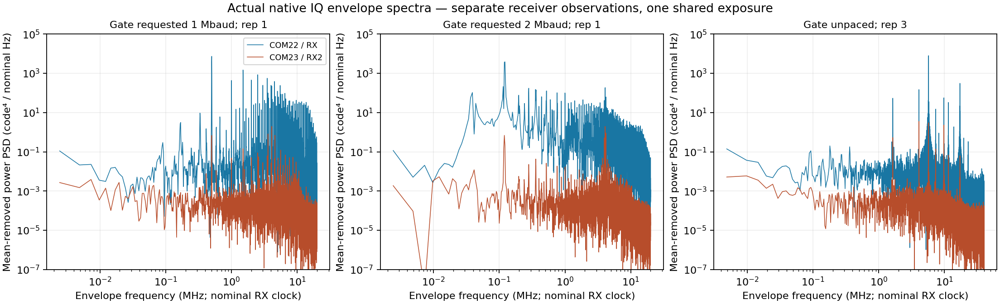

# Metal TX software rates and received envelope observations

**The campaign remains FAILED:** 39 unmasked exposures passed the complete TX/RX correlation, then the first masked exposure lacked a full TX result. Forty of 54 planned exposures were attempted; the remaining 14 were NOT RUN. Both child captures preserve 39 `ACQUIRED` and one `FAILED` exposure. Existing native/envelope tools analyze only the 39 strict exposures per receiver. This report separately verifies and describes the final receiver-only bodies without promoting that failed coupled exposure.

All closed parent/child artifact hashes, shared TX logs, runtime source/profile/MAC identities and exact image hashes verify. TX is S3 COM13/MAC `1c2904becc48`, source `3b4161fbcbd6832264019aa3a4fb993a85798857`, image SHA256 `d04e2792b42f53412b1d7e98eb2a1f52c5bc1fa5c22a9d3092498e8ddf5cdd45`. RX is COM22/MAC `1c2904bec3a0`; RX2 is COM23/MAC `1c2904bec3d8`; both use the same `s3-metal-snapshot` source and image SHA256 `468c2187cc447510561038212539fdbeab3a95298024d412c13db2e6b2d85e7e`. TX uses experimental direct PHY; receivers explicitly use WiFi_NULL,2433 MHz, offset −80 kHz and gain index 40. Each one-second TX repeats 64 alternating preloaded bits, with observer stride 0. All 39 strict cases are unmasked. The complete init/tune/allocation/heap/source-digest receipts remain in JSON.

Each row is three repetitions of one shared TX observed by two independent receivers, not six RF trials. “Software” is processed store/call count divided by target CPU-cycle elapsed time at reported 240 MHz. It is not RF bit throughput. “Peak” is the independently selected, mean-removed I²+Q² power-spectrum FFT peak, in nominal-clock kHz. The bin spacing is 0.9768 kHz at 16 MS/s, 2.4420 kHz at 40 MS/s and 4.8840 kHz at 80 MS/s; ranges below are the three actual peak bins, not fitted frequency precision.

| Mode / requested kbaud | Software kstores/s median | Skipped source slots median | RX peak kHz range | RX qualified /3 | RX2 peak kHz range |
| --- | ---: | ---: | ---: | ---: | ---: |
| api / 1 | 1.000 | 0 | 0.977 | 0/3 | 0.977–4,100.611 |
| ram / 100 | 99.995 | 5 | 49.817 | 3/3 | 49.817–4,097.680 |
| gate / 23 | 22.999 | 1 | 11.722 | 3/3 | 4,093.773–4,095.726 |
| gate / 100 | 99.994 | 6 | 49.817 | 3/3 | 4,090.842–4,092.796 |
| gate / 250 | 248.985 | 1,015 | 125.031 | 3/3 | 4,088.889–4,090.842 |
| gate / 500 | 497.969 | 2,031 | 250.061 | 3/3 | 4,086.935–4,087.912 |
| gate / 1000 | 994.934 | 5,066 | 500.611 | 3/3 | 4,085.470 |
| gate / 2000 | 875.587 | 1,124,412 | 119.658–122.100 | 3/3 | 4,085.470 |
| gate / 4000 | 874.671 | 3,125,325 | 239.316–244.200 | 3/3 | 4,083.028 |
| gate / 8000 | 875.298 | 7,124,701 | 371.184–376.068 | 2/3 | 4,083.028 |
| gate / 16000 | 875.628 | 15,124,360 | 68.376–73.260 | 3/3 | 4,083.028 |
| gate / 32000 | 861.663 | 31,138,320 | 122.100–126.984 | 3/3 | 4,083.028 |
| gate / unpaced | 11,366.485 | 0 | 5,719.170–5,724.054 | 1/3 | 4,083.028 |

**RX/COM22:** RAM 100k and gate 23k, 100k, 250k, 500k and 1M show strong separated power levels with qualified threshold crossings in all three repetitions. Their observed peaks are consistent, within their nominal FFT bins, with half the requested alternating baud. Across all strict cases,33/39 RX snapshots meet the default qualification. Above requested 1M, the generic paced loop skips large numbers of source slots: requested 2–32M produces only about 0.862–0.876 million writes/s, and dominant received peaks no longer follow requested baud/2. Skipping source indices also changes the repeated alternating waveform; a local peak is not expected to equal half the whole-loop average in those cases. These observations identify limits of this loop/control pattern, not an ultimate hardware modulation ceiling.

**Unpaced stores:** the minimal unpaced loop reports 11,366,485–11,366,516 writes/s, approximately 21.115 CPU cycles per write including its loop/control/interrupt cost. RX contains a strong 5.719–5.724 MHz envelope component. Only the third repetition meets the default robust two-level gate; the other two retain null qualified duty/edge intervals because robust level separation fails. In the qualified snapshot, rising periods have median 14 native samples (0.175 µs at the nominal 80 MHz clock), with p95 of 15 samples. This is a threshold-crossing observation with one-sample granularity, not calibrated RF-edge jitter, a decoded 11 Mbit/s stream, or validated audio/payload throughput.

**RX2/COM23:** zero of 39 strict snapshots meets the same edge-qualification criteria. Many spectra are dominated by a roughly 4.08–4.10 MHz feature rather than the requested alternating frequency, and code-domain power is much lower. Qualification failure leaves duty and edge distributions **null**, not zero latency or absent RF. Geometry, antenna/coupling, gain calibration, LO/interference, init state and other receiver differences have not been independently isolated. Equal gain indices and common image hashes do not establish equal calibrated analog gain. No board-brand or unsupported-hardware conclusion follows.

**Finite observation horizon:** the 1 kbaud API case supplies only 0.512 expected 500 Hz cycles in the longest 1,023.75 µs snapshot. It cannot establish steady 500 Hz periodicity or a meaningful edge-interval distribution; do not interpret its dominant FFT bin or incidental crossings as the source clock. The default gates require at least three AC-peak cycles, three crossings of each polarity, power-quantile ratio≥4, robust level separation≥4, AC-peak concentration≥0.1 and state occupancy≥5%. These are declared heuristics, not RF SNR. Qualified intervals exclude censored first/last widths; all rejected cases retain reasons and null qualified values.

These selected actual spectra compare independent receiver observations of one exposure per panel. They use the complete positive-frequency FFT bins from the analyzer CSVs, a symmetric Hann window and mean-removed power. The requested 2M case visibly differs from the requested half-rate reference; the unpaced component is distinct from the slower generic paced loop. Spectral frequencies use nominal receiver clocks; code⁴/Hz is not calibrated RF power or unique proof of transmitter origin. Full spectra and every qualified threshold crossing remain in the per-receiver envelope folders.

**Final masked exposure (`d040_1`):** both native receiver payloads independently pass SHA256, length, CRC/LF, source ID, hardware-done, canary and owner/lane-restoration checks. Both receiver run-end records report success. The received TX stream has `tx_starting`, 498 segment records and matching `tx_end`, but zero complete `tx_result` records: a raw text line begins with a result tail. TX software rate, register-restore and teardown verification are therefore **unknown**, and the coupled exposure remains FAILED. No lost prefix is reconstructed from fragments. A separate RX-body-only calculation gives a 500.611 kHz peak and qualified threshold crossings on RX; RX2 gives a 4.080586 MHz peak with unqualified edges. These two conditional body observations are kept outside the 39-exposure rate/qualification aggregates. A suspected serialization problem requires a separate source/image/capture cohort to confirm its cause.

All 40 receiver bodies per board remain retained; the strict39-per-board analyses and the conditional final-body calculation have distinct scopes. Receiver run-boundary heap is 216,016 B free INTERNAL|8BIT, 172,032 B largest before/after throughout, with zero transfer-failure deltas. No sampled in-loop heap minimum or temperature was measured: temperature queries were disabled. Reported `late_cycles` refers to a pending deadline before source slots are skipped; it is backlog evidence, not final output-symbol jitter. Host/board clocks remain independent, and no synchronized one-way latency, BER, framed payload decoding, analog output or audio-quality proof is claimed.

Outputs: [RX native analysis](metal-rate-wifi-rx-analysis/METAL-REPORT.md), [RX2 native analysis](metal-rate-wifi-rx2-analysis/METAL-REPORT.md), [RX envelope JSON](metal-rate-wifi-rx-envelope/results.json), [RX2 envelope JSON](metal-rate-wifi-rx2-envelope/results.json), [per-repetition CSV](METAL-RATE-WIFI-FINDINGS.csv), [complete findings JSON](METAL-RATE-WIFI-FINDINGS.json), [vector spectra](METAL-RATE-WIFI-SPECTRA.svg). The findings manifest pins these outputs and the original closed inputs.
