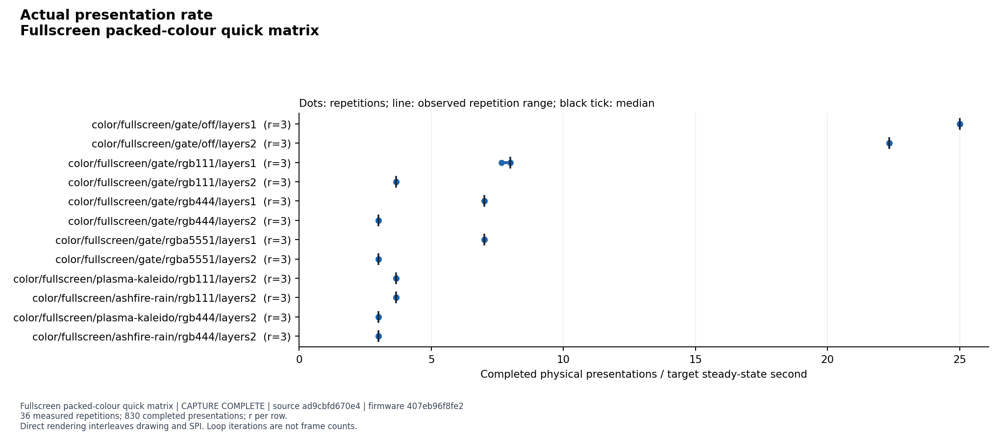

# CYD performance evidence — Fullscreen packed-colour quick matrix

Capture status: **CAPTURE COMPLETE**. Completed physical runs: **36/36**; pending or incomplete: **0**. Explicit NOT RUN workload classes: **0**.

Board: CYD on COM21 (owner identified), ESP32-D0WD-V3 revision 3.1. Source [ad9cbfd670e456de5e08fca19810fb93f7f1db47](https://github.com/techrote/cyd-diviner/commit/ad9cbfd670e456de5e08fca19810fb93f7f1db47); profile `cyd-profile-audio`; firmware SHA256 `407eb96f8fe2b74ed1cf45f4a163558eacde0ff287a4b878a9ed1faadfaccc93`. Input results SHA256 `f7910e7a3877c33ceee35e9d71d32665e4b5009f5e0a00fc6824e54b97a5614e`.

CPU 240 MHz, 2 cores; flash 4194304 bytes at 40000000 Hz; PSRAM 0 bytes. LCD SPI write/read 40000000/8000000 Hz; serial 533333 baud. SDK `v4.4.7-dirty`.

Fixed plan seed: `23063`. Ordinary requested warmup/window: 1000/3000 ms; default repetitions: 3. Per-case overrides remain in [results.json](../PHYSICAL-CAPTURES-COLOR.zip) (archive member `physical/color-quick-01/results.json`). Reset policy: `fresh_audio_DSP_state_each_entry_seeded_no_song_persistence`. Audio-window alignment: `real_setup_and_warmup_elapsed_not_sample_aligned`.

Saved display settings at initial inventory: theme 2, background style 1, gradient mode 1, canvas depth 16 bits. Orientation/backdrop commands then override the inventory values per workload. The exact palette, intensity table, setup acknowledgements and actual scene receipts are retained in JSON/raw logs.

## Interpretation

FPS is completed physical presentations divided by the target window, with the existing 33 ms frame cap. CPU percentages use tick-sampled current-task versus idle-task classification, not cycle-accurate task or interrupt accounting. Direct rendering interleaves CPU drawing and SPI transfer; its present duration cannot be separated into independent raster and bus costs. Histogram percentiles below are **upper bounds**. Human tables tighten each bound to `min(raw powers-of-two bucket upper, exact observed maximum)`; a capped bound equal to the maximum is still a bound, not an exact percentile. Raw target records and summary CSVs retain the original bucket upper bounds unchanged. Maxima are exact observed durations. A p99 is omitted below 100 observations. Percentiles and maxima describe these finite runs; they are not deadline guarantees.

Only repetitions with matching requested settings, duration, warmup, instrumentation and actual scene/allocation receipts are pooled. A scope suffix identifies variants if the same workload name has differing receipts. Independent maxima or percentiles must not be added as if they came from the same audio block.

Instrumentation A/B scope: `histogram_insertion_only_timestamps_hooks_counts_retained`. The enable switch controls histogram insertion while timestamps, hooks, frame/block counts and retained sampling remain. The on/off rows therefore measure that insertion change only. Total overhead relative to an ordinary firmware binary is not established by this switch. Disabled histograms give unavailable timing distributions rather than zero-duration work. The approved primary image reserves 24,008 bytes in its static histogram/sample arrays alone; other profiler state, queues and task stacks are additional. These arrays remain with insertion disabled. Reported heap describes the profiling image and workload history; ordinary firmware headroom cannot be inferred by subtracting only this footprint. Detailed source and method audits are in the repository's `evidence/method-notes.md`.

## Physical scene envelopes

| Workload | reps | presents | FPS | interval p95≤/max ms | present p95≤/max ms | CPU0/1 % | min free/largest B |
| --- | --- | --- | --- | --- | --- | --- | --- |
| color/fullscreen/gate/off/layers1 | 3 | 225 | 25.00 | 41.13/41.13 | 38.01/38.01 | 12.5/95.0 | 88508/47092 |
| color/fullscreen/gate/off/layers2 | 3 | 201 | 22.33 | 46.24/46.24 | 43.53/43.53 | 12.5/97.3 | 88508/47092 |
| color/fullscreen/gate/rgb111/layers1 | 3 | 71 | 7.89 | 130.14/130.14 | 127.02/127.02 | 12.5/98.5 | 88508/47092 |
| color/fullscreen/gate/rgb111/layers2 | 3 | 33 | 3.67 | 285.27/285.27 | 282.33/282.33 | 12.5/99.3 | 88508/47092 |
| color/fullscreen/gate/rgb444/layers1 | 3 | 63 | 7.00 | 148.33/148.33 | 145.56/145.56 | 12.5/99.2 | 88508/47092 |
| color/fullscreen/gate/rgb444/layers2 | 3 | 27 | 3.00 | 334.00/334.00 | 331.02/331.02 | 12.5/99.5 | 88508/47092 |
| color/fullscreen/gate/rgba5551/layers1 | 3 | 63 | 7.00 | 148.34/148.34 | 145.63/145.63 | 12.5/99.2 | 88508/47092 |
| color/fullscreen/gate/rgba5551/layers2 | 3 | 27 | 3.00 | 331.38/331.38 | 328.31/328.31 | 12.5/99.5 | 88508/47092 |
| color/fullscreen/plasma-kaleido/rgb111/layers2 | 3 | 33 | 3.67 | 274.21/274.21 | 271.19/271.19 | 12.5/99.3 | 88508/47092 |
| color/fullscreen/ashfire-rain/rgb111/layers2 | 3 | 33 | 3.67 | 280.18/280.18 | 278.79/278.79 | 12.5/99.5 | 81408/47092 |
| color/fullscreen/plasma-kaleido/rgb444/layers2 | 3 | 27 | 3.00 | 323.11/323.11 | 319.93/319.93 | 12.5/99.4 | 88508/47092 |
| color/fullscreen/ashfire-rain/rgb444/layers2 | 3 | 27 | 3.00 | 328.98/328.98 | 327.40/327.40 | 12.5/99.5 | 81408/47092 |

Free/largest heap values are minima of retained samples in each scope, not continuous allocation traces. Boot-wide heap low water and task-lifetime stack low water are separate fields in the summary; they cannot identify a per-scene leak alone.

## Touchscreen polling and control dispatch

NOT RUN / no completed observations in this capture.

The selection includes the menu baseline, the slowest captured fullscreen scope per orientation and scripted-touch cases. Polling rate is the measured `touch_poll_us` observation count divided by target steady-window elapsed time: actual XPT2046 `getPoint` calls, including polls with no contact. It is an average call rate, not a guaranteed polling interval or physical touch response rate. `touch_dispatch_us` counts control-dispatch invocations, including no-contact samples and synthetic input; it does not count distinct physical touches or generated application keys. Scripted replay is firmware injection. No controlled physical contact stimulus, contact-to-photon acquisition or physical latency distribution was measured.

## Audio scheduling

Configured audio: 24000 Hz, 128 samples/block (5333.333 µs nominal block period). Audio task core/priority 0/5; PCM writer core/priority 1/2. I2S inventory: 4 DMA buffers × 128 frames, 2 slots, DAC GPIO 26.

| Workload | callback n | callback p95≤/max µs | lock max µs | mix max µs | enqueue p95≤/max µs | period p99≤/max µs | late/write/short |
| --- | --- | --- | --- | --- | --- | --- | --- |
| color/fullscreen/gate/off/layers1 | 1688 | 351/351 | 3 | 31 | 4953/4953 | 5396/5396 | 0/0/0 |
| color/fullscreen/gate/off/layers2 | 1686 | 351/351 | 4 | 31 | 4954/4954 | 5336/5336 | 0/0/0 |
| color/fullscreen/gate/rgb111/layers1 | 1688 | 354/354 | 4 | 31 | 4953/4953 | 5342/5342 | 0/0/0 |
| color/fullscreen/gate/rgb444/layers1 | 1688 | 350/350 | 4 | 31 | 4956/4956 | 5339/5339 | 0/0/0 |
| color/fullscreen/gate/rgb444/layers2 | 1686 | 351/351 | 4 | 31 | 4966/4966 | 5361/5361 | 0/0/0 |
| color/fullscreen/plasma-kaleido/rgb111/layers2 | 1688 | 355/355 | 4 | 31 | 4954/4954 | 5334/5334 | 0/0/0 |

The table includes explicit audio/combined/stress workloads and the scopes with the largest observed callback, cadence, lock or enqueue tails. Enqueue is the duration of blocking `i2s_write`, including waiting for DMA capacity. It is not an isolated compute cost. Late-period counters are inferred scheduling events. DMA underruns and analog output continuity are **unknown** without an appropriate detector/acquisition fixture. The complete lock, callback, overlay, mix, enqueue and cadence distributions are in [summary-metrics.csv](summary-metrics.csv).

## USB PCM integrity

NOT RUN / no completed observations in this capture.

PCM receive windows include warmup, the steady target window, a 250 ms guard and stop-tail draining. Target counters cover the steady target window only. Missing sequence numbers can originate in a producer queue or transport; compare target queue/drop records before attribution. Loss before the first received sequence and after the last frame is unknown. Host arrival timing includes UART/OS buffering and cannot establish target audio cadence or DMA underruns. Raw per-run PCM binaries can be replayed with `capture.py decode-pcm`.

## Sustained CPU load and temperature

NOT RUN / no completed observations in this capture.

Recorded sensor method: `RTC_library_raw_undocumented_uncalibrated`. The sensor API is undocumented and its temperature accuracy is unsupported. Raw readings are uncalibrated indications. The reported °C values are the firmware's conversion, not independently calibrated die temperature. Ambient temperature was NOT MEASURED. Retained intervals, raw ticks and all sensor samples are available in [samples.csv](../PHYSICAL-CAPTURES-COLOR.zip) (archive member `physical/color-quick-01/samples.csv`). The confirmation predicate requires a completed ≥360-second window, ≥360 seconds of retained sample span, valid CPU hooks and ≥95% weighted busy time on both cores.

Stress iteration counters are unsigned 32-bit modular progress indicators, incremented in batches of 256; they can wrap modulo 2^32. They are not throughput totals. Timed windows and retained raw per-core tick observations support the sustained-load assessment.

Across this capture, **72** retained in-window samples and outside-kernel/SPI snapshots span raw sensor codes **136–138**. These indications show the recorded trend without supplying an accuracy or calibration claim.

## SPI and portable kernels

NOT RUN / no completed observations in this capture.

SPI uses precomputed RGB565 eight-row stripes, includes commands and completion waits, and excludes artwork generation. It measures this transfer path, not an abstract SPI clock-rate ceiling.

NOT RUN / no completed observations in this capture.

Kernel timings pool exact chronological samples and include RTOS preemption. Output inspection is excluded. Working bytes describe kernel state; they are not the bytes that a remote node would need per request. The same seed and checksum checks support reproduction, while float/fixed-point precision comparisons remain separate validation evidence. Physical S3/C3 comparative execution is NOT RUN unless separately evidenced; a successful target build is not a hardware measurement.

## Actual scene and allocation receipts

| Workload | scope | actual configuration before measurement |
| --- | --- | --- |
| color/fullscreen/gate/off/layers1 | 5bedd516b564 | scene=color, seed=23063, reset=fresh_DSP_state_each_entry, song_persistence=False, enabled=False, format=off, source_raster_format=RGB565, source_raster_bits_per_pixel=16, output_spi_format=RGB565, output_spi_bits_per_pixel=16, output_width_px=320, output_height_px=240, packed_colour_bits_per_pixel=0, packed_alpha_bits_per_pixel=0, external_coverage_bits_per_pixel=0, packed_storage_bits_per_pixel=0, base_effect=plasma, overlay_effect=kaleido, effect_layers=2, surface_band_rows=8, packed_stride_bytes=0, packed_base_payload_bytes=0, packed_overlay_payload_bytes=0, coverage_payload_bytes=0, packed_total_payload_bytes=0, rgb565_dma_strip_count=2, rgb565_dma_reserved_bytes=10240, scratch_required_bytes=10240, canvas_backing_reserved_bytes=64800, backing_reservation_changed=False, layout_fits=True, temporal_pixel_history=False, storage_scope=reused_8_row_packed_intermediates_in_existing_canvas, coverage_scope=binary_changed_pixels_after_existing_RGB565_overlay_blending; not_native_A1_raster, fullscreen_trails_method=existing_bounded_geometric_paths, receipt_scope=configuration_layout_before_next_frame, link_info_formatter_capacity_bytes=4096, link_summary_formatter_capacity_bytes=3072; actual_base_effect=gate, actual_layered=False, history_requested=False, history_ready=False, history_format=NONE, history_payload_bytes=0, tunnel_allocated=True, tunnel_payload_bytes=13920, fire_allocated=False, fire_payload_bytes=0, native_fullscreen_at_receipt=False |
| color/fullscreen/gate/off/layers2 | a1ca65014b6c | scene=color, seed=23063, reset=fresh_DSP_state_each_entry, song_persistence=False, enabled=False, format=off, source_raster_format=RGB565, source_raster_bits_per_pixel=16, output_spi_format=RGB565, output_spi_bits_per_pixel=16, output_width_px=320, output_height_px=240, packed_colour_bits_per_pixel=0, packed_alpha_bits_per_pixel=0, external_coverage_bits_per_pixel=0, packed_storage_bits_per_pixel=0, base_effect=gate, overlay_effect=none, effect_layers=1, surface_band_rows=8, packed_stride_bytes=0, packed_base_payload_bytes=0, packed_overlay_payload_bytes=0, coverage_payload_bytes=0, packed_total_payload_bytes=0, rgb565_dma_strip_count=2, rgb565_dma_reserved_bytes=10240, scratch_required_bytes=10240, canvas_backing_reserved_bytes=64800, backing_reservation_changed=False, layout_fits=True, temporal_pixel_history=False, storage_scope=reused_8_row_packed_intermediates_in_existing_canvas, coverage_scope=binary_changed_pixels_after_existing_RGB565_overlay_blending; not_native_A1_raster, fullscreen_trails_method=existing_bounded_geometric_paths, receipt_scope=configuration_layout_before_next_frame, link_info_formatter_capacity_bytes=4096, link_summary_formatter_capacity_bytes=3072; actual_base_effect=gate, actual_layered=True, history_requested=True, history_ready=True, history_format=LUT8, history_payload_bytes=27840, tunnel_allocated=True, tunnel_payload_bytes=13920, fire_allocated=False, fire_payload_bytes=0, native_fullscreen_at_receipt=False |
| color/fullscreen/gate/rgb111/layers1 | 20a1b46c9577 | scene=color, seed=23063, reset=fresh_DSP_state_each_entry, song_persistence=False, enabled=True, format=rgb111, source_raster_format=RGB565, source_raster_bits_per_pixel=16, output_spi_format=RGB565, output_spi_bits_per_pixel=16, output_width_px=320, output_height_px=240, packed_colour_bits_per_pixel=3, packed_alpha_bits_per_pixel=0, external_coverage_bits_per_pixel=1, packed_storage_bits_per_pixel=3, base_effect=gate, overlay_effect=trails, effect_layers=2, surface_band_rows=8, packed_stride_bytes=120, packed_base_payload_bytes=960, packed_overlay_payload_bytes=960, coverage_payload_bytes=320, packed_total_payload_bytes=2240, rgb565_dma_strip_count=2, rgb565_dma_reserved_bytes=10240, scratch_required_bytes=12480, canvas_backing_reserved_bytes=64800, backing_reservation_changed=False, layout_fits=True, temporal_pixel_history=False, storage_scope=reused_8_row_packed_intermediates_in_existing_canvas, coverage_scope=binary_changed_pixels_after_existing_RGB565_overlay_blending; not_native_A1_raster, fullscreen_trails_method=existing_bounded_geometric_paths, receipt_scope=configuration_layout_before_next_frame, link_info_formatter_capacity_bytes=4096, link_summary_formatter_capacity_bytes=3072; actual_base_effect=gate, actual_layered=False, history_requested=False, history_ready=False, history_format=NONE, history_payload_bytes=0, tunnel_allocated=True, tunnel_payload_bytes=13920, fire_allocated=False, fire_payload_bytes=0, native_fullscreen_at_receipt=False |
| color/fullscreen/gate/rgb111/layers2 | 13283be1c36d | scene=color, seed=23063, reset=fresh_DSP_state_each_entry, song_persistence=False, enabled=True, format=rgb111, source_raster_format=RGB565, source_raster_bits_per_pixel=16, output_spi_format=RGB565, output_spi_bits_per_pixel=16, output_width_px=320, output_height_px=240, packed_colour_bits_per_pixel=3, packed_alpha_bits_per_pixel=0, external_coverage_bits_per_pixel=0, packed_storage_bits_per_pixel=3, base_effect=gate, overlay_effect=none, effect_layers=1, surface_band_rows=8, packed_stride_bytes=120, packed_base_payload_bytes=960, packed_overlay_payload_bytes=0, coverage_payload_bytes=0, packed_total_payload_bytes=960, rgb565_dma_strip_count=2, rgb565_dma_reserved_bytes=10240, scratch_required_bytes=11200, canvas_backing_reserved_bytes=64800, backing_reservation_changed=False, layout_fits=True, temporal_pixel_history=False, storage_scope=reused_8_row_packed_intermediates_in_existing_canvas, coverage_scope=binary_changed_pixels_after_existing_RGB565_overlay_blending; not_native_A1_raster, fullscreen_trails_method=existing_bounded_geometric_paths, receipt_scope=configuration_layout_before_next_frame, link_info_formatter_capacity_bytes=4096, link_summary_formatter_capacity_bytes=3072; actual_base_effect=gate, actual_layered=True, history_requested=True, history_ready=True, history_format=LUT8, history_payload_bytes=27840, tunnel_allocated=True, tunnel_payload_bytes=13920, fire_allocated=False, fire_payload_bytes=0, native_fullscreen_at_receipt=False |
| color/fullscreen/gate/rgb444/layers1 | a189feb6aa11 | scene=color, seed=23063, reset=fresh_DSP_state_each_entry, song_persistence=False, enabled=True, format=rgb444, source_raster_format=RGB565, source_raster_bits_per_pixel=16, output_spi_format=RGB565, output_spi_bits_per_pixel=16, output_width_px=320, output_height_px=240, packed_colour_bits_per_pixel=12, packed_alpha_bits_per_pixel=0, external_coverage_bits_per_pixel=1, packed_storage_bits_per_pixel=12, base_effect=gate, overlay_effect=trails, effect_layers=2, surface_band_rows=8, packed_stride_bytes=480, packed_base_payload_bytes=3840, packed_overlay_payload_bytes=3840, coverage_payload_bytes=320, packed_total_payload_bytes=8000, rgb565_dma_strip_count=2, rgb565_dma_reserved_bytes=10240, scratch_required_bytes=18240, canvas_backing_reserved_bytes=64800, backing_reservation_changed=False, layout_fits=True, temporal_pixel_history=False, storage_scope=reused_8_row_packed_intermediates_in_existing_canvas, coverage_scope=binary_changed_pixels_after_existing_RGB565_overlay_blending; not_native_A1_raster, fullscreen_trails_method=existing_bounded_geometric_paths, receipt_scope=configuration_layout_before_next_frame, link_info_formatter_capacity_bytes=4096, link_summary_formatter_capacity_bytes=3072; actual_base_effect=gate, actual_layered=False, history_requested=False, history_ready=False, history_format=NONE, history_payload_bytes=0, tunnel_allocated=True, tunnel_payload_bytes=13920, fire_allocated=False, fire_payload_bytes=0, native_fullscreen_at_receipt=False |
| color/fullscreen/gate/rgb444/layers2 | ee91ab632e81 | scene=color, seed=23063, reset=fresh_DSP_state_each_entry, song_persistence=False, enabled=True, format=rgb444, source_raster_format=RGB565, source_raster_bits_per_pixel=16, output_spi_format=RGB565, output_spi_bits_per_pixel=16, output_width_px=320, output_height_px=240, packed_colour_bits_per_pixel=12, packed_alpha_bits_per_pixel=0, external_coverage_bits_per_pixel=0, packed_storage_bits_per_pixel=12, base_effect=gate, overlay_effect=none, effect_layers=1, surface_band_rows=8, packed_stride_bytes=480, packed_base_payload_bytes=3840, packed_overlay_payload_bytes=0, coverage_payload_bytes=0, packed_total_payload_bytes=3840, rgb565_dma_strip_count=2, rgb565_dma_reserved_bytes=10240, scratch_required_bytes=14080, canvas_backing_reserved_bytes=64800, backing_reservation_changed=False, layout_fits=True, temporal_pixel_history=False, storage_scope=reused_8_row_packed_intermediates_in_existing_canvas, coverage_scope=binary_changed_pixels_after_existing_RGB565_overlay_blending; not_native_A1_raster, fullscreen_trails_method=existing_bounded_geometric_paths, receipt_scope=configuration_layout_before_next_frame, link_info_formatter_capacity_bytes=4096, link_summary_formatter_capacity_bytes=3072; actual_base_effect=gate, actual_layered=True, history_requested=True, history_ready=True, history_format=LUT8, history_payload_bytes=27840, tunnel_allocated=True, tunnel_payload_bytes=13920, fire_allocated=False, fire_payload_bytes=0, native_fullscreen_at_receipt=False |
| color/fullscreen/gate/rgba5551/layers1 | e268b1ab011b | scene=color, seed=23063, reset=fresh_DSP_state_each_entry, song_persistence=False, enabled=True, format=rgba5551, source_raster_format=RGB565, source_raster_bits_per_pixel=16, output_spi_format=RGB565, output_spi_bits_per_pixel=16, output_width_px=320, output_height_px=240, packed_colour_bits_per_pixel=15, packed_alpha_bits_per_pixel=1, external_coverage_bits_per_pixel=0, packed_storage_bits_per_pixel=16, base_effect=gate, overlay_effect=trails, effect_layers=2, surface_band_rows=8, packed_stride_bytes=640, packed_base_payload_bytes=5120, packed_overlay_payload_bytes=5120, coverage_payload_bytes=0, packed_total_payload_bytes=10240, rgb565_dma_strip_count=2, rgb565_dma_reserved_bytes=10240, scratch_required_bytes=20480, canvas_backing_reserved_bytes=64800, backing_reservation_changed=False, layout_fits=True, temporal_pixel_history=False, storage_scope=reused_8_row_packed_intermediates_in_existing_canvas, coverage_scope=binary_changed_pixels_after_existing_RGB565_overlay_blending; not_native_A1_raster, fullscreen_trails_method=existing_bounded_geometric_paths, receipt_scope=configuration_layout_before_next_frame, link_info_formatter_capacity_bytes=4096, link_summary_formatter_capacity_bytes=3072; actual_base_effect=gate, actual_layered=False, history_requested=False, history_ready=False, history_format=NONE, history_payload_bytes=0, tunnel_allocated=True, tunnel_payload_bytes=13920, fire_allocated=False, fire_payload_bytes=0, native_fullscreen_at_receipt=False |
| color/fullscreen/gate/rgba5551/layers2 | 0ff1bb4d529d | scene=color, seed=23063, reset=fresh_DSP_state_each_entry, song_persistence=False, enabled=True, format=rgba5551, source_raster_format=RGB565, source_raster_bits_per_pixel=16, output_spi_format=RGB565, output_spi_bits_per_pixel=16, output_width_px=320, output_height_px=240, packed_colour_bits_per_pixel=15, packed_alpha_bits_per_pixel=1, external_coverage_bits_per_pixel=0, packed_storage_bits_per_pixel=16, base_effect=gate, overlay_effect=none, effect_layers=1, surface_band_rows=8, packed_stride_bytes=640, packed_base_payload_bytes=5120, packed_overlay_payload_bytes=0, coverage_payload_bytes=0, packed_total_payload_bytes=5120, rgb565_dma_strip_count=2, rgb565_dma_reserved_bytes=10240, scratch_required_bytes=15360, canvas_backing_reserved_bytes=64800, backing_reservation_changed=False, layout_fits=True, temporal_pixel_history=False, storage_scope=reused_8_row_packed_intermediates_in_existing_canvas, coverage_scope=binary_changed_pixels_after_existing_RGB565_overlay_blending; not_native_A1_raster, fullscreen_trails_method=existing_bounded_geometric_paths, receipt_scope=configuration_layout_before_next_frame, link_info_formatter_capacity_bytes=4096, link_summary_formatter_capacity_bytes=3072; actual_base_effect=gate, actual_layered=True, history_requested=True, history_ready=True, history_format=LUT8, history_payload_bytes=27840, tunnel_allocated=True, tunnel_payload_bytes=13920, fire_allocated=False, fire_payload_bytes=0, native_fullscreen_at_receipt=False |
| color/fullscreen/plasma-kaleido/rgb111/layers2 | 26499e1f40a9 | scene=color, seed=23063, reset=fresh_DSP_state_each_entry, song_persistence=False, enabled=True, format=rgb111, source_raster_format=RGB565, source_raster_bits_per_pixel=16, output_spi_format=RGB565, output_spi_bits_per_pixel=16, output_width_px=320, output_height_px=240, packed_colour_bits_per_pixel=3, packed_alpha_bits_per_pixel=0, external_coverage_bits_per_pixel=1, packed_storage_bits_per_pixel=3, base_effect=gate, overlay_effect=trails, effect_layers=2, surface_band_rows=8, packed_stride_bytes=120, packed_base_payload_bytes=960, packed_overlay_payload_bytes=960, coverage_payload_bytes=320, packed_total_payload_bytes=2240, rgb565_dma_strip_count=2, rgb565_dma_reserved_bytes=10240, scratch_required_bytes=12480, canvas_backing_reserved_bytes=64800, backing_reservation_changed=False, layout_fits=True, temporal_pixel_history=False, storage_scope=reused_8_row_packed_intermediates_in_existing_canvas, coverage_scope=binary_changed_pixels_after_existing_RGB565_overlay_blending; not_native_A1_raster, fullscreen_trails_method=existing_bounded_geometric_paths, receipt_scope=configuration_layout_before_next_frame, link_info_formatter_capacity_bytes=4096, link_summary_formatter_capacity_bytes=3072; actual_base_effect=plasma, actual_layered=True, history_requested=False, history_ready=False, history_format=NONE, history_payload_bytes=0, tunnel_allocated=False, tunnel_payload_bytes=0, fire_allocated=False, fire_payload_bytes=0, native_fullscreen_at_receipt=False |
| color/fullscreen/ashfire-rain/rgb111/layers2 | 314996995629 | scene=color, seed=23063, reset=fresh_DSP_state_each_entry, song_persistence=False, enabled=True, format=rgb111, source_raster_format=RGB565, source_raster_bits_per_pixel=16, output_spi_format=RGB565, output_spi_bits_per_pixel=16, output_width_px=320, output_height_px=240, packed_colour_bits_per_pixel=3, packed_alpha_bits_per_pixel=0, external_coverage_bits_per_pixel=1, packed_storage_bits_per_pixel=3, base_effect=plasma, overlay_effect=kaleido, effect_layers=2, surface_band_rows=8, packed_stride_bytes=120, packed_base_payload_bytes=960, packed_overlay_payload_bytes=960, coverage_payload_bytes=320, packed_total_payload_bytes=2240, rgb565_dma_strip_count=2, rgb565_dma_reserved_bytes=10240, scratch_required_bytes=12480, canvas_backing_reserved_bytes=64800, backing_reservation_changed=False, layout_fits=True, temporal_pixel_history=False, storage_scope=reused_8_row_packed_intermediates_in_existing_canvas, coverage_scope=binary_changed_pixels_after_existing_RGB565_overlay_blending; not_native_A1_raster, fullscreen_trails_method=existing_bounded_geometric_paths, receipt_scope=configuration_layout_before_next_frame, link_info_formatter_capacity_bytes=4096, link_summary_formatter_capacity_bytes=3072; actual_base_effect=ashfire, actual_layered=True, history_requested=False, history_ready=False, history_format=NONE, history_payload_bytes=0, tunnel_allocated=False, tunnel_payload_bytes=0, fire_allocated=True, fire_payload_bytes=7081, native_fullscreen_at_receipt=False |
| color/fullscreen/plasma-kaleido/rgb444/layers2 | b9f9c58be6bc | scene=color, seed=23063, reset=fresh_DSP_state_each_entry, song_persistence=False, enabled=True, format=rgb444, source_raster_format=RGB565, source_raster_bits_per_pixel=16, output_spi_format=RGB565, output_spi_bits_per_pixel=16, output_width_px=320, output_height_px=240, packed_colour_bits_per_pixel=12, packed_alpha_bits_per_pixel=0, external_coverage_bits_per_pixel=1, packed_storage_bits_per_pixel=12, base_effect=ashfire, overlay_effect=rain, effect_layers=2, surface_band_rows=8, packed_stride_bytes=480, packed_base_payload_bytes=3840, packed_overlay_payload_bytes=3840, coverage_payload_bytes=320, packed_total_payload_bytes=8000, rgb565_dma_strip_count=2, rgb565_dma_reserved_bytes=10240, scratch_required_bytes=18240, canvas_backing_reserved_bytes=64800, backing_reservation_changed=False, layout_fits=True, temporal_pixel_history=False, storage_scope=reused_8_row_packed_intermediates_in_existing_canvas, coverage_scope=binary_changed_pixels_after_existing_RGB565_overlay_blending; not_native_A1_raster, fullscreen_trails_method=existing_bounded_geometric_paths, receipt_scope=configuration_layout_before_next_frame, link_info_formatter_capacity_bytes=4096, link_summary_formatter_capacity_bytes=3072; actual_base_effect=plasma, actual_layered=True, history_requested=False, history_ready=False, history_format=NONE, history_payload_bytes=0, tunnel_allocated=False, tunnel_payload_bytes=0, fire_allocated=False, fire_payload_bytes=0, native_fullscreen_at_receipt=False |
| color/fullscreen/ashfire-rain/rgb444/layers2 | c2578aecebd0 | scene=color, seed=23063, reset=fresh_DSP_state_each_entry, song_persistence=False, enabled=True, format=rgb444, source_raster_format=RGB565, source_raster_bits_per_pixel=16, output_spi_format=RGB565, output_spi_bits_per_pixel=16, output_width_px=320, output_height_px=240, packed_colour_bits_per_pixel=12, packed_alpha_bits_per_pixel=0, external_coverage_bits_per_pixel=1, packed_storage_bits_per_pixel=12, base_effect=plasma, overlay_effect=kaleido, effect_layers=2, surface_band_rows=8, packed_stride_bytes=480, packed_base_payload_bytes=3840, packed_overlay_payload_bytes=3840, coverage_payload_bytes=320, packed_total_payload_bytes=8000, rgb565_dma_strip_count=2, rgb565_dma_reserved_bytes=10240, scratch_required_bytes=18240, canvas_backing_reserved_bytes=64800, backing_reservation_changed=False, layout_fits=True, temporal_pixel_history=False, storage_scope=reused_8_row_packed_intermediates_in_existing_canvas, coverage_scope=binary_changed_pixels_after_existing_RGB565_overlay_blending; not_native_A1_raster, fullscreen_trails_method=existing_bounded_geometric_paths, receipt_scope=configuration_layout_before_next_frame, link_info_formatter_capacity_bytes=4096, link_summary_formatter_capacity_bytes=3072; actual_base_effect=ashfire, actual_layered=True, history_requested=False, history_ready=False, history_format=NONE, history_payload_bytes=0, tunnel_allocated=False, tunnel_payload_bytes=0, fire_allocated=True, fire_payload_bytes=7081, native_fullscreen_at_receipt=False |

Visions receipts are emitted after configuration and before the next frame. For native fullscreen trails the implementation uses bounded geometric paths and releases pixel history/tunnel on its first fullscreen frame; receipt-time allocated bytes must not be presented as measured fullscreen history occupancy. Sampled heap provides the in-window evidence. These paths are not numerically identical rendering kernels.

## Wireless scope

Radio rows measure isolated controller initialization and its effect on local scenes. They perform no peer discovery, association or traffic. Radio-off acknowledgements record requested software state; disable/deinitialize return statuses and actual RF emissions are not independently exported or measured. This is a requested-state baseline, not independently verified RF-off operation. No measured goodput, RTT, jitter/loss under traffic, or Wi-Fi/BLE/ESP-NOW coexistence envelope is established by these rows.

NOT RUN / no completed observations in this capture.

## I2S driver event capability

| Run | Workload | enabled | available | observed | TX_Q_OVF | DMA_ERROR | TX_DONE | queue-full observations | drain-limit hits | max drain gap µs |
| --- | --- | --- | --- | --- | --- | --- | --- | --- | --- | --- |
| r001_1 | color/fullscreen/gate/off/layers1 | True | True | True | 0 | 0 | 563 | 0 | 0 | 5373 |
| r002_2 | color/fullscreen/gate/off/layers1 | True | True | True | 0 | 0 | 563 | 0 | 0 | 5334 |
| r003_3 | color/fullscreen/gate/off/layers1 | True | True | True | 0 | 0 | 562 | 0 | 0 | 5334 |
| r004_1 | color/fullscreen/gate/off/layers2 | True | True | True | 0 | 0 | 563 | 0 | 0 | 5334 |
| r005_2 | color/fullscreen/gate/off/layers2 | True | True | True | 0 | 0 | 562 | 0 | 0 | 5336 |
| r006_3 | color/fullscreen/gate/off/layers2 | True | True | True | 0 | 0 | 562 | 0 | 0 | 5336 |
| r007_1 | color/fullscreen/gate/rgb111/layers1 | True | True | True | 0 | 0 | 562 | 0 | 0 | 5335 |
| r008_2 | color/fullscreen/gate/rgb111/layers1 | True | True | True | 0 | 0 | 563 | 0 | 0 | 5340 |
| r009_3 | color/fullscreen/gate/rgb111/layers1 | True | True | True | 0 | 0 | 563 | 0 | 0 | 5340 |
| r010_1 | color/fullscreen/gate/rgb111/layers2 | True | True | True | 0 | 0 | 563 | 0 | 0 | 5335 |
| r011_2 | color/fullscreen/gate/rgb111/layers2 | True | True | True | 0 | 0 | 563 | 0 | 0 | 5335 |
| r012_3 | color/fullscreen/gate/rgb111/layers2 | True | True | True | 0 | 0 | 563 | 0 | 0 | 5338 |
| r013_1 | color/fullscreen/gate/rgb444/layers1 | True | True | True | 0 | 0 | 563 | 0 | 0 | 5334 |
| r014_2 | color/fullscreen/gate/rgb444/layers1 | True | True | True | 0 | 0 | 562 | 0 | 0 | 5340 |
| r015_3 | color/fullscreen/gate/rgb444/layers1 | True | True | True | 0 | 0 | 563 | 0 | 0 | 5334 |
| r016_1 | color/fullscreen/gate/rgb444/layers2 | True | True | True | 0 | 0 | 562 | 0 | 0 | 5354 |
| r017_2 | color/fullscreen/gate/rgb444/layers2 | True | True | True | 0 | 0 | 562 | 0 | 0 | 5334 |
| r018_3 | color/fullscreen/gate/rgb444/layers2 | True | True | True | 0 | 0 | 562 | 0 | 0 | 5334 |
| r019_1 | color/fullscreen/gate/rgba5551/layers1 | True | True | True | 0 | 0 | 563 | 0 | 0 | 5334 |
| r020_2 | color/fullscreen/gate/rgba5551/layers1 | True | True | True | 0 | 0 | 562 | 0 | 0 | 5335 |
| r021_3 | color/fullscreen/gate/rgba5551/layers1 | True | True | True | 0 | 0 | 562 | 0 | 0 | 5334 |
| r022_1 | color/fullscreen/gate/rgba5551/layers2 | True | True | True | 0 | 0 | 562 | 0 | 0 | 5335 |
| r023_2 | color/fullscreen/gate/rgba5551/layers2 | True | True | True | 0 | 0 | 562 | 0 | 0 | 5334 |
| r024_3 | color/fullscreen/gate/rgba5551/layers2 | True | True | True | 0 | 0 | 563 | 0 | 0 | 5334 |
| r025_1 | color/fullscreen/plasma-kaleido/rgb111/layers2 | True | True | True | 0 | 0 | 563 | 0 | 0 | 5334 |
| r026_2 | color/fullscreen/plasma-kaleido/rgb111/layers2 | True | True | True | 0 | 0 | 562 | 0 | 0 | 5334 |
| r027_3 | color/fullscreen/plasma-kaleido/rgb111/layers2 | True | True | True | 0 | 0 | 563 | 0 | 0 | 5334 |
| r028_1 | color/fullscreen/ashfire-rain/rgb111/layers2 | True | True | True | 0 | 0 | 563 | 0 | 0 | 5335 |
| r029_2 | color/fullscreen/ashfire-rain/rgb111/layers2 | True | True | True | 0 | 0 | 562 | 0 | 0 | 5335 |
| r030_3 | color/fullscreen/ashfire-rain/rgb111/layers2 | True | True | True | 0 | 0 | 562 | 0 | 0 | 5335 |
| r031_1 | color/fullscreen/plasma-kaleido/rgb444/layers2 | True | True | True | 0 | 0 | 562 | 0 | 0 | 5334 |
| r032_2 | color/fullscreen/plasma-kaleido/rgb444/layers2 | True | True | True | 0 | 0 | 562 | 0 | 0 | 5334 |
| r033_3 | color/fullscreen/plasma-kaleido/rgb444/layers2 | True | True | True | 0 | 0 | 562 | 0 | 0 | 5335 |
| r034_1 | color/fullscreen/ashfire-rain/rgb444/layers2 | True | True | True | 0 | 0 | 563 | 0 | 0 | 5335 |
| r035_2 | color/fullscreen/ashfire-rain/rgb444/layers2 | True | True | True | 0 | 0 | 562 | 0 | 0 | 5335 |
| r036_3 | color/fullscreen/ashfire-rain/rgb444/layers2 | True | True | True | 0 | 0 | 563 | 0 | 0 | 5335 |

These are directly observed legacy I2S driver indications. TX_Q_OVF means the driver's free-TX-buffer queue was full; the raw schema's legacy `tx_underflow_indications` field counts that enum and is not a measured analog gap count. DMA_ERROR is a descriptor fault. Assignment to a measurement window is by event-drain completion time, not ISR generation time. Finite driver queues and polling can lose indications; queue/drain diagnostics bound visibility but do not establish an exact loss count. Zero indications do not prove analog continuity.

## Evidence-based recommendations

* Use scene-specific display budgets: the lowest completed cadence among the captured ordinary scopes is **3.00 FPS** for `color/fullscreen/gate/rgb444/layers2` across 3 repetitions. Use the measured tail/maximum durations and actual path when choosing VIBEWARE visual complexity; do not apply the menu rate to layered fullscreen effects.
* The largest observed main audio callback is **355 µs** in `color/fullscreen/plasma-kaleido/rgb111/layers2` (n=1688, nominal block period 5333.333 µs). Keep callback, lock, overlay, mix and blocking enqueue as separate budgets; verify correlated per-block deadlines and analog continuity before claiming an underrun-free audio envelope.
* Offload break-even requires local compute to exceed remote compute, packing/unpacking, queueing and measured transport for the actual input/output message shapes. A full matched-payload RTT already includes its payload transfer: do not add that transmission a second time. A fixed-overhead/throughput model instead needs independently estimated fixed overhead and directional byte-transfer costs. No numeric minimum useful ratio can be established from controller-init-only radio tests.
* Reserve memory using the observed free/largest-block minima and allocation receipts for the intended combination of effects. Saved-palette gradients, history format, fullscreen path and radio initialization are workload settings, not incidental details. Repeat matching scene transitions and long sessions before diagnosing a leak or guaranteeing a memory margin.

## Missing evidence and reproduction

NOT RUN / no completed observations in this capture.

Current unfinished planned repetitions: 0. Missing observations stay absent rather than receiving theoretical estimates.

Reproduce with the captured plan, identified board, exact firmware digest and matching source/toolchain receipts. The harness never flashes. Owner authorization, private backup verification and the flash receipt are separate evidence. The on-board identity does not independently attest the firmware binary digest; preserve the flash/build chain.

```powershell
python tools/perf/capture.py analyze evidence/physical/Fullscreen packed-colour quick matrix/results.json
python tools/perf/summarize.py evidence/physical/Fullscreen packed-colour quick matrix/results.json
python tools/perf/report.py evidence/physical/Fullscreen packed-colour quick matrix/results.json --label Fullscreen packed-colour quick matrix
```

Artifacts: [results.json](../PHYSICAL-CAPTURES-COLOR.zip) (archive member `physical/color-quick-01/results.json`), [raw target JSONL](../PHYSICAL-CAPTURES-COLOR.zip) (archive member `physical/color-quick-01/target.jsonl`), [raw serial bytes](../PHYSICAL-CAPTURES-COLOR.zip) (archive member `physical/color-quick-01/serial-rx.bin`), [timestamped serial events](../PHYSICAL-CAPTURES-COLOR.zip) (archive member `physical/color-quick-01/serial-events.jsonl`), [metrics.csv](../PHYSICAL-CAPTURES-COLOR.zip) (archive member `physical/color-quick-01/metrics.csv`), [samples.csv](../PHYSICAL-CAPTURES-COLOR.zip) (archive member `physical/color-quick-01/samples.csv`), [summary.json](summary.json), [summary scenes](summary-scenes.csv), [summary metrics](summary-metrics.csv), [summary kernels](summary-kernels.csv), [artifact checksums](../PHYSICAL-CAPTURES-COLOR.zip) (archive member `physical/color-quick-01/artifact-hashes.json`).

## Plots



## Publication bundle

This compact folder derives from the **completed** `Fullscreen packed-colour quick matrix` capture and preserves status **CAPTURE COMPLETE**. The [raw capture archive](../PHYSICAL-CAPTURES-COLOR.zip) has SHA256 `0e1eec6eea902cba428cf37f63e50a2a5f0d505d827cafaf7a5690731a593cee`; its `physical/color-quick-01/` members preserve the full JSON, samples, target telemetry, serial RX, PCM and event logs. Extract the archive into `evidence/` while retaining its `physical/` prefix before replaying the commands above. [stress-samples.csv](stress-samples.csv) contains 0 stress-only rows with source/firmware/profile identity, target timestamps, raw ticks, CPU percentages, sensor readings, heap and stack. An empty table means that no stress workload was present in this source capture. [manifest.json](manifest.json) records input/output hashes and archive-member verification.
