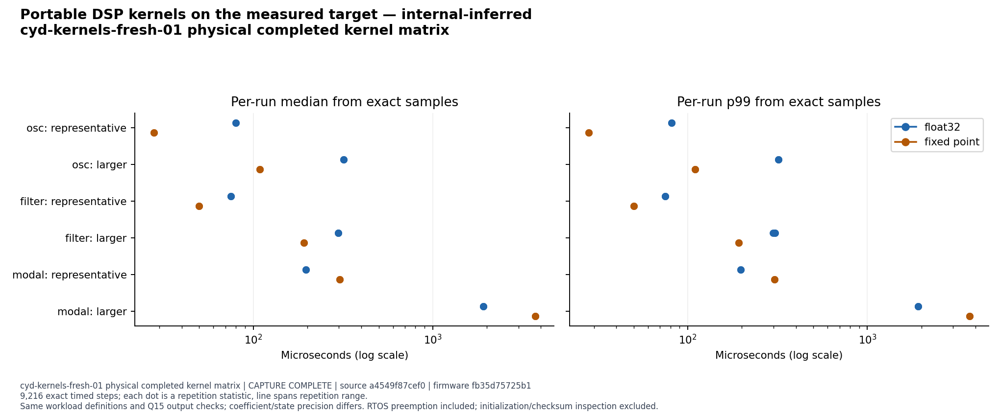
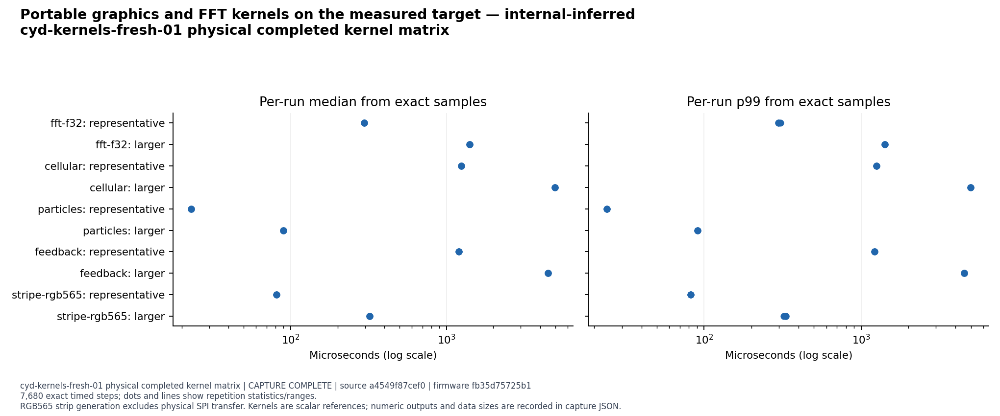

# Portable kernel evidence — cyd-kernels-fresh-01

Capture status: **CAPTURE COMPLETE**. Valid completed cases: **66/66 registered repetitions**. Only MEASURED cases are summarized; partial target records remain raw evidence.

Board: CYD on COM21 (owner identified), ESP32-D0WD-V3 revision 3.1; profile `cyd-profile`. Source [a4549f87cef05d19d9acf96d59ae95a2435ebb67](https://github.com/techrote/cyd-diviner/commit/a4549f87cef05d19d9acf96d59ae95a2435ebb67); firmware SHA256 `fb35d75725b15ecd8b6aceb368492cf76ebaee85bbb4aeb50bd61311e229f15c`; input results SHA256 `cb4d53d91c8d625acab8faed07bbf91aa58a726ccc7e65d6a0510b09ed0dc41d`.

CPU 240 MHz; flash 4194304 bytes at 40000000 Hz; initialized PSRAM heap 0 bytes. Nominal package PSRAM: NOT SEPARATELY RECORDED bytes. Standalone: `False`; ordinary audio/display worker flags: `profiling context` / `profiling context`.

The kernel suite uses three warmup steps, reinitializes from the fixed seed, then records 256 exact step timings per case. Allocation, preparation, warmup, yields and output inspection are excluded; RTOS preemption during a step is included. Percentiles below pool exact timings across matching completed repetitions. Different memory-region/settings scopes remain separate. A kernel timing sample is not a physical display frame or audio deadline guarantee.

## Measured kernels

| Kernel | size | memory scope | reps | n | median µs | p95 µs | p99 µs | max µs | working B | output B | fingerprint stable |
| --- | --- | --- | --- | --- | --- | --- | --- | --- | --- | --- | --- |
| osc-f32 | realistic | internal (inferred_zero_psram) | 3 | 768 | 80 | 81 | 81 | 84 | 9248 | 256 | True |
| osc-f32 | large | internal (inferred_zero_psram) | 3 | 768 | 318 | 319 | 319 | 331 | 9248 | 1024 | True |
| osc-q15 | realistic | internal (inferred_zero_psram) | 3 | 768 | 28 | 28 | 28 | 32 | 9248 | 256 | True |
| osc-q15 | large | internal (inferred_zero_psram) | 3 | 768 | 109 | 110 | 110 | 114 | 9248 | 1024 | True |
| filter-f32 | realistic | internal (inferred_zero_psram) | 3 | 768 | 75 | 75 | 75 | 79 | 9248 | 256 | True |
| filter-f32 | large | internal (inferred_zero_psram) | 3 | 768 | 297 | 306 | 306 | 310 | 9248 | 1024 | True |
| filter-q15 | realistic | internal (inferred_zero_psram) | 3 | 768 | 50 | 50 | 50 | 54 | 9248 | 256 | True |
| filter-q15 | large | internal (inferred_zero_psram) | 3 | 768 | 192 | 192 | 192 | 196 | 9248 | 1024 | True |
| modal-f32 | realistic | internal (inferred_zero_psram) | 3 | 768 | 196 | 197 | 197 | 200 | 9248 | 256 | True |
| modal-f32 | large | internal (inferred_zero_psram) | 3 | 768 | 1916 | 1924 | 1924 | 1935 | 9248 | 1024 | True |
| modal-q15 | realistic | internal (inferred_zero_psram) | 3 | 768 | 304 | 305 | 305 | 308 | 9248 | 256 | True |
| modal-q15 | large | internal (inferred_zero_psram) | 3 | 768 | 3713 | 3714 | 3715 | 3731 | 9248 | 1024 | True |
| fft-f32 | realistic | internal (inferred_zero_psram) | 3 | 768 | 297 | 298 | 306 | 306 | 12292 | 2048 | True |
| fft-f32 | large | internal (inferred_zero_psram) | 3 | 768 | 1405 | 1414 | 1414 | 1418 | 12292 | 8192 | True |
| cellular | realistic | internal (inferred_zero_psram) | 3 | 768 | 1247 | 1256 | 1256 | 1261 | 24588 | 3072 | True |
| cellular | large | internal (inferred_zero_psram) | 3 | 768 | 4977 | 4979 | 4979 | 4996 | 24588 | 12288 | True |
| particles | realistic | internal (inferred_zero_psram) | 3 | 768 | 23 | 24 | 24 | 28 | 8196 | 2048 | True |
| particles | large | internal (inferred_zero_psram) | 3 | 768 | 90 | 91 | 91 | 94 | 8196 | 8192 | True |
| feedback | realistic | internal (inferred_zero_psram) | 3 | 768 | 1201 | 1214 | 1217 | 1218 | 38696 | 4800 | True |
| feedback | large | internal (inferred_zero_psram) | 3 | 768 | 4489 | 4525 | 4528 | 4530 | 38696 | 19200 | True |
| stripe-rgb565 | realistic | internal (inferred_zero_psram) | 3 | 768 | 81 | 82 | 82 | 85 | 10252 | 2560 | True |
| stripe-rgb565 | large | internal (inferred_zero_psram) | 3 | 768 | 322 | 331 | 331 | 331 | 10252 | 10240 | True |

Working bytes are active algorithm state; the target separately reports the complete allocated workspace. The same allocation capabilities and data sizes must be used for a cross-board comparison. The classic CYD profiling image has concurrent audio/display tasks and a 24,008-byte static observer-array footprint; a standalone S3 image has a different context. Ordinary firmware memory headroom cannot be recovered by subtracting that footprint alone. The repository's `evidence/method-notes.md` and `tools/perf/KERNELS.md` document context, precision and fingerprint semantics.

FFT's legacy `checksum_fnv1a` field composes separate real/imaginary fingerprints with XOR. Float bit fingerprints may differ across architectures; numerical error and host double-precision comparisons are separate correctness evidence. Stable repeated fingerprints do not by themselves establish equivalent float/fixed-point precision.

## Sensor and allocation snapshots

| Field | n | minimum | maximum |
| --- | --- | --- | --- |
| temperature_raw | 132 | 137 | 139 |

Recorded sensor method: `ESP32_ROM_raw_uncalibrated`. The classic ESP32 raw RTC-library indication and its legacy ROM tag are undocumented/uncalibrated; they do not establish accurate die temperature. Snapshot ranges are outside kernel timing windows. Neither these snapshots nor the numeric conversion establish a sustained stress or calibrated cross-chip thermal comparison.

## Bounds and remaining work

Only the listed board/profile, kernel sizes, memory regions and finite repetitions were measured. This capture establishes no C3 physical performance, local DAC/display cadence, direct driver-underrun count or wireless throughput/RTT. Unlisted combinations in a failed incremental plan remain unmeasured. Preserve the failed stream and protocol error; do not infer timings from truncated JSON.

Compute time per output byte in [summary-kernels.csv](summary-kernels.csv) nominates offload experiments. It excludes required input/state transfers, serialization, measured link tails and remote scheduling. A speedup requires local compute to exceed remote compute plus packing/unpacking, remote queueing and measured transport for the actual input/output message shapes. Do not add payload transmission again to a full matched-payload RTT. A separate fixed-overhead/throughput model requires independently estimated fixed overhead and directional transfer costs. No wireless benefit is asserted by these kernels alone.

Artifacts: [results.json](../PHYSICAL-CAPTURES-BASELINE.zip) (archive member `physical/cyd-kernels-fresh-01/results.json`), [target records](../PHYSICAL-CAPTURES-BASELINE.zip) (archive member `physical/cyd-kernels-fresh-01/target.jsonl`), [serial RX](../PHYSICAL-CAPTURES-BASELINE.zip) (archive member `physical/cyd-kernels-fresh-01/serial-rx.bin`), [serial events](../PHYSICAL-CAPTURES-BASELINE.zip) (archive member `physical/cyd-kernels-fresh-01/serial-events.jsonl`), [samples.csv](../PHYSICAL-CAPTURES-BASELINE.zip) (archive member `physical/cyd-kernels-fresh-01/samples.csv`), [summary.json](summary.json), [summary kernels](summary-kernels.csv), [artifact checksums](../PHYSICAL-CAPTURES-BASELINE.zip) (archive member `physical/cyd-kernels-fresh-01/artifact-hashes.json`).

## Plots

## Publication bundle

This compact folder derives from the **completed** `cyd-kernels-fresh-01` capture and preserves status **CAPTURE COMPLETE**. The [raw capture archive](../PHYSICAL-CAPTURES-BASELINE.zip) has SHA256 `41f122a120c5f4207f6d30b01d3c0b4be67728a200ba89154fa3d957d38a7797`; its `physical/cyd-kernels-fresh-01/` members preserve the full JSON, samples, target telemetry, serial RX, PCM and event logs. Extract the archive into `evidence/` while retaining its `physical/` prefix before replaying the commands above. [stress-samples.csv](stress-samples.csv) contains 0 stress-only rows with source/firmware/profile identity, target timestamps, raw ticks, CPU percentages, sensor readings, heap and stack. An empty table means that no stress workload was present in this source capture. [manifest.json](manifest.json) records input/output hashes and archive-member verification.
