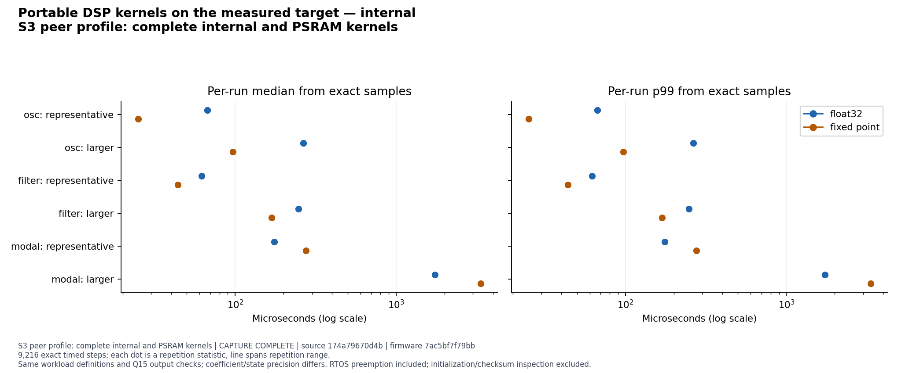
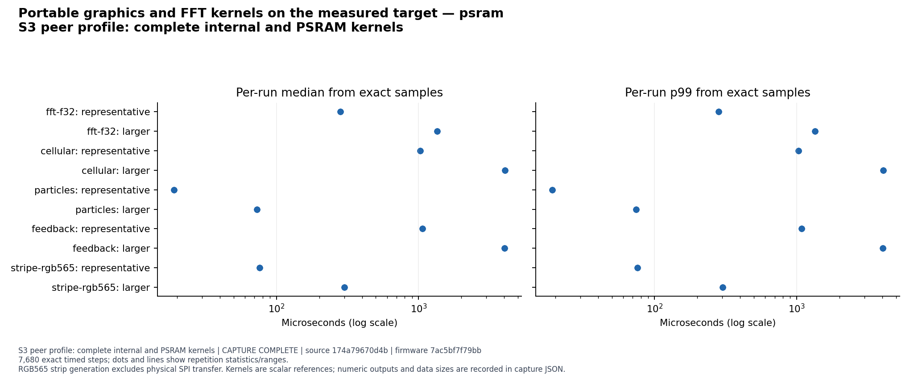

# Portable kernel evidence — S3 complete internal and PSRAM kernel matrix

Capture status: **CAPTURE COMPLETE**. Valid completed cases: **132/132 registered repetitions**. Only MEASURED cases are summarized; partial target records remain raw evidence.

Board: Owner ESP32-S3 on COM22, embedded 4 MB flash / 2 MB PSRAM; profile `kernel-s3-n4r2-peer`. Source [174a79670d4b0da656ebd615f0cd1620aa0ddbb1](https://github.com/techrote/cyd-diviner/commit/174a79670d4b0da656ebd615f0cd1620aa0ddbb1); firmware SHA256 `7ac5bf7f79bb2ed6048a40367fe1d3966a1d5e53a999b2f09f28f310456bb681`; input results SHA256 `d89c28832226ddbe53db4efa2a1faa6876d1eb531ef3fb7d1f5c7017405a312d`.

CPU 240 MHz; flash 4194304 bytes at 80000000 Hz; initialized PSRAM heap 2095087 bytes. Nominal package PSRAM: 2097152 bytes. Standalone: `True`; ordinary audio/display worker flags: `False` / `False`.

The kernel suite uses three warmup steps, reinitializes from the fixed seed, then records 256 exact step timings per case. Allocation, preparation, warmup, yields and output inspection are excluded; RTOS preemption during a step is included. Percentiles below pool exact timings across matching completed repetitions. Different memory-region/settings scopes remain separate. A kernel timing sample is not a physical display frame or audio deadline guarantee.

## Measured kernels

| Kernel | size | memory scope | reps | n | median µs | p95 µs | p99 µs | max µs | working B | output B | fingerprint stable |
| --- | --- | --- | --- | --- | --- | --- | --- | --- | --- | --- | --- |
| osc-f32 | realistic | internal (target_verified_capability_allocation) | 3 | 768 | 67 | 67 | 67 | 68 | 9248 | 256 | True |
| osc-f32 | large | internal (target_verified_capability_allocation) | 3 | 768 | 265 | 265 | 265 | 266 | 9248 | 1024 | True |
| osc-q15 | realistic | internal (target_verified_capability_allocation) | 3 | 768 | 25 | 25 | 25 | 26 | 9248 | 256 | True |
| osc-q15 | large | internal (target_verified_capability_allocation) | 3 | 768 | 97 | 97 | 97 | 98 | 9248 | 1024 | True |
| filter-f32 | realistic | internal (target_verified_capability_allocation) | 3 | 768 | 62 | 62 | 62 | 65 | 9248 | 256 | True |
| filter-f32 | large | internal (target_verified_capability_allocation) | 3 | 768 | 248 | 248 | 248 | 250 | 9248 | 1024 | True |
| filter-q15 | realistic | internal (target_verified_capability_allocation) | 3 | 768 | 44 | 44 | 44 | 46 | 9248 | 256 | True |
| filter-q15 | large | internal (target_verified_capability_allocation) | 3 | 768 | 169 | 169 | 169 | 172 | 9248 | 1024 | True |
| modal-f32 | realistic | internal (target_verified_capability_allocation) | 3 | 768 | 175 | 175 | 175 | 176 | 9248 | 256 | True |
| modal-f32 | large | internal (target_verified_capability_allocation) | 3 | 768 | 1741 | 1741 | 1741 | 1748 | 9248 | 1024 | True |
| modal-q15 | realistic | internal (target_verified_capability_allocation) | 3 | 768 | 275 | 275 | 276 | 276 | 9248 | 256 | True |
| modal-q15 | large | internal (target_verified_capability_allocation) | 3 | 768 | 3346 | 3347 | 3347 | 3353 | 9248 | 1024 | True |
| fft-f32 | realistic | internal (target_verified_capability_allocation) | 3 | 768 | 282 | 282 | 282 | 283 | 12292 | 2048 | True |
| fft-f32 | large | internal (target_verified_capability_allocation) | 3 | 768 | 1350 | 1350 | 1350 | 1358 | 12292 | 8192 | True |
| cellular | realistic | internal (target_verified_capability_allocation) | 3 | 768 | 1026 | 1027 | 1028 | 1030 | 24588 | 3072 | True |
| cellular | large | internal (target_verified_capability_allocation) | 3 | 768 | 4065 | 4067 | 4067 | 4072 | 24588 | 12288 | True |
| particles | realistic | internal (target_verified_capability_allocation) | 3 | 768 | 19 | 19 | 19 | 19 | 8196 | 2048 | True |
| particles | large | internal (target_verified_capability_allocation) | 3 | 768 | 73 | 73 | 74 | 74 | 8196 | 8192 | True |
| feedback | realistic | internal (target_verified_capability_allocation) | 3 | 768 | 1069 | 1082 | 1083 | 1083 | 38696 | 4800 | True |
| feedback | large | internal (target_verified_capability_allocation) | 3 | 768 | 3974 | 3974 | 3974 | 3981 | 38696 | 19200 | True |
| stripe-rgb565 | realistic | internal (target_verified_capability_allocation) | 3 | 768 | 76 | 76 | 76 | 77 | 10252 | 2560 | True |
| stripe-rgb565 | large | internal (target_verified_capability_allocation) | 3 | 768 | 301 | 301 | 301 | 302 | 10252 | 10240 | True |
| osc-f32 | realistic | psram (target_verified_capability_allocation) | 3 | 768 | 67 | 67 | 67 | 68 | 9248 | 256 | True |
| osc-f32 | large | psram (target_verified_capability_allocation) | 3 | 768 | 265 | 265 | 265 | 266 | 9248 | 1024 | True |
| osc-q15 | realistic | psram (target_verified_capability_allocation) | 3 | 768 | 25 | 25 | 25 | 26 | 9248 | 256 | True |
| osc-q15 | large | psram (target_verified_capability_allocation) | 3 | 768 | 97 | 97 | 97 | 98 | 9248 | 1024 | True |
| filter-f32 | realistic | psram (target_verified_capability_allocation) | 3 | 768 | 62 | 62 | 62 | 64 | 9248 | 256 | True |
| filter-f32 | large | psram (target_verified_capability_allocation) | 3 | 768 | 248 | 248 | 248 | 251 | 9248 | 1024 | True |
| filter-q15 | realistic | psram (target_verified_capability_allocation) | 3 | 768 | 44 | 44 | 44 | 46 | 9248 | 256 | True |
| filter-q15 | large | psram (target_verified_capability_allocation) | 3 | 768 | 169 | 169 | 169 | 172 | 9248 | 1024 | True |
| modal-f32 | realistic | psram (target_verified_capability_allocation) | 3 | 768 | 175 | 175 | 175 | 177 | 9248 | 256 | True |
| modal-f32 | large | psram (target_verified_capability_allocation) | 3 | 768 | 1741 | 1741 | 1741 | 1748 | 9248 | 1024 | True |
| modal-q15 | realistic | psram (target_verified_capability_allocation) | 3 | 768 | 275 | 275 | 276 | 276 | 9248 | 256 | True |
| modal-q15 | large | psram (target_verified_capability_allocation) | 3 | 768 | 3346 | 3347 | 3347 | 3352 | 9248 | 1024 | True |
| fft-f32 | realistic | psram (target_verified_capability_allocation) | 3 | 768 | 282 | 282 | 282 | 284 | 12292 | 2048 | True |
| fft-f32 | large | psram (target_verified_capability_allocation) | 3 | 768 | 1350 | 1350 | 1350 | 1358 | 12292 | 8192 | True |
| cellular | realistic | psram (target_verified_capability_allocation) | 3 | 768 | 1026 | 1027 | 1028 | 1030 | 24588 | 3072 | True |
| cellular | large | psram (target_verified_capability_allocation) | 3 | 768 | 4065 | 4067 | 4067 | 4073 | 24588 | 12288 | True |
| particles | realistic | psram (target_verified_capability_allocation) | 3 | 768 | 19 | 19 | 19 | 20 | 8196 | 2048 | True |
| particles | large | psram (target_verified_capability_allocation) | 3 | 768 | 73 | 73 | 74 | 74 | 8196 | 8192 | True |
| feedback | realistic | psram (target_verified_capability_allocation) | 3 | 768 | 1069 | 1082 | 1083 | 1083 | 38696 | 4800 | True |
| feedback | large | psram (target_verified_capability_allocation) | 3 | 768 | 4021 | 4039 | 4047 | 4055 | 38696 | 19200 | True |
| stripe-rgb565 | realistic | psram (target_verified_capability_allocation) | 3 | 768 | 76 | 76 | 76 | 76 | 10252 | 2560 | True |
| stripe-rgb565 | large | psram (target_verified_capability_allocation) | 3 | 768 | 301 | 301 | 301 | 301 | 10252 | 10240 | True |

Working bytes are active algorithm state; the target separately reports the complete allocated workspace. The same allocation capabilities and data sizes must be used for a cross-board comparison. The classic CYD profiling image has concurrent audio/display tasks and a 24,008-byte static observer-array footprint; a standalone S3 image has a different context. Ordinary firmware memory headroom cannot be recovered by subtracting that footprint alone. The repository's `evidence/method-notes.md` and `tools/perf/KERNELS.md` document context, precision and fingerprint semantics.

FFT's legacy `checksum_fnv1a` field composes separate real/imaginary fingerprints with XOR. Float bit fingerprints may differ across architectures; numerical error and host double-precision comparisons are separate correctness evidence. Stable repeated fingerprints do not by themselves establish equivalent float/fixed-point precision.

## Sensor and allocation snapshots

| Field | n | minimum | maximum |
| --- | --- | --- | --- |
| temperature_c_indication | 265 | 37.100 | 42.100 |
| heap_internal_free_bytes | 265 | 291236 | 291236 |
| heap_internal_largest_bytes | 265 | 262132 | 262132 |
| heap_psram_free_bytes | 265 | 2086895 | 2086895 |
| heap_psram_largest_bytes | 265 | 2064372 | 2064372 |

Recorded sensor method: `Arduino_IDF_driver_Celsius_indication_external_accuracy_not_verified`. The S3 driver Celsius indication has not been independently checked against an external temperature reference. Snapshot ranges are outside kernel timing windows. Neither these snapshots nor the numeric conversion establish a sustained stress or calibrated cross-chip thermal comparison.

## Bounds and remaining work

Only the listed board/profile, kernel sizes, memory regions and finite repetitions were measured. This capture establishes no C3 physical performance, local DAC/display cadence, direct driver-underrun count or wireless throughput/RTT. Unlisted combinations in a failed incremental plan remain unmeasured. Preserve the failed stream and protocol error; do not infer timings from truncated JSON.

Compute time per output byte in [summary-kernels.csv](summary-kernels.csv) nominates offload experiments. It excludes required input/state transfers, serialization, measured link tails and remote scheduling. A speedup requires local compute to exceed remote compute plus packing/unpacking, remote queueing and measured transport for the actual input/output message shapes. Do not add payload transmission again to a full matched-payload RTT. A separate fixed-overhead/throughput model requires independently estimated fixed overhead and directional transfer costs. No wireless benefit is asserted by these kernels alone.

Artifacts: [results.json](../PHYSICAL-CAPTURES-SUPPLEMENT.zip) (archive member `physical/s3-kernels-link-03/results.json`), [target records](../PHYSICAL-CAPTURES-SUPPLEMENT.zip) (archive member `physical/s3-kernels-link-03/target.jsonl`), [serial RX](../PHYSICAL-CAPTURES-SUPPLEMENT.zip) (archive member `physical/s3-kernels-link-03/serial-rx.bin`), [serial events](../PHYSICAL-CAPTURES-SUPPLEMENT.zip) (archive member `physical/s3-kernels-link-03/serial-events.jsonl`), [samples.csv](../PHYSICAL-CAPTURES-SUPPLEMENT.zip) (archive member `physical/s3-kernels-link-03/samples.csv`), [summary.json](summary.json), [summary kernels](summary-kernels.csv), [artifact checksums](../PHYSICAL-CAPTURES-SUPPLEMENT.zip) (archive member `physical/s3-kernels-link-03/artifact-hashes.json`).

## Plots

## Publication bundle

This compact folder derives from the **completed** `S3 complete internal and PSRAM kernel matrix` capture and preserves status **CAPTURE COMPLETE**. The [raw capture archive](../PHYSICAL-CAPTURES-SUPPLEMENT.zip) has SHA256 `15dcd4b987177ca3c8c7e504a1e9a41eef1f342414519519ce9610b3100cf8a7`; its `physical/s3-kernels-link-03/` members preserve the full JSON, samples, target telemetry, serial RX, PCM and event logs. Extract the archive into `evidence/` while retaining its `physical/` prefix before replaying the commands above. [stress-samples.csv](stress-samples.csv) contains 0 stress-only rows with source/firmware/profile identity, target timestamps, raw ticks, CPU percentages, sensor readings, heap and stack. An empty table means that no stress workload was present in this source capture. [manifest.json](manifest.json) records input/output hashes and archive-member verification.
