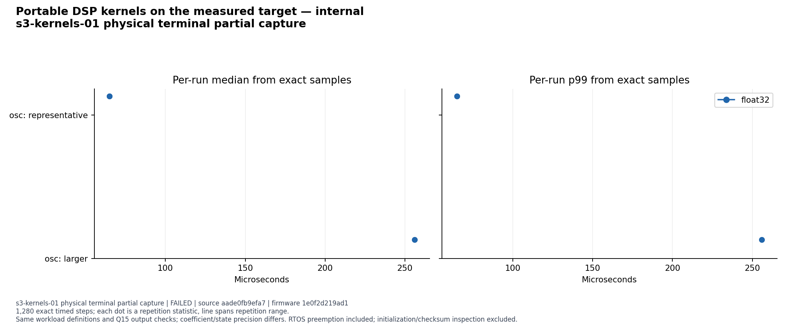

# Portable kernel evidence — s3-kernels-01

Capture status: **FAILED**. Valid completed cases: **5/6 registered repetitions**. Only MEASURED cases are summarized; partial target records remain raw evidence.

This historical portable harness registered its workload plan incrementally. The failed snapshot lists cases reached, not every remaining kernel/size/memory-region combination. Its registered denominator is not a completed full-matrix claim.

Recorded failure: `TimeoutError("No target 'state' record for None after 20s")`.

Board: Owner ESP32-S3 on COM22, embedded 4 MB flash / 2 MB PSRAM; profile `kernel-s3-n4r2`. Source [aade0fb9efa7083c4b215791f5bdd43c15040fc5](https://github.com/techrote/cyd-diviner/commit/aade0fb9efa7083c4b215791f5bdd43c15040fc5); firmware SHA256 `1e0f2d219ad1dd8837b876151ba41465df71bb78f4d903bfe801a477659ebaaf`; input results SHA256 `8f841f8d4d6b0fab857e6823652597d6415b3ed6508f2cadde8454e42463449f`.

CPU 240 MHz; flash 4194304 bytes at 80000000 Hz; initialized PSRAM heap 2095103 bytes. Nominal package PSRAM: 2097152 bytes. Standalone: `True`; ordinary audio/display worker flags: `False` / `False`.

The kernel suite uses three warmup steps, reinitializes from the fixed seed, then records 256 exact step timings per case. Allocation, preparation, warmup, yields and output inspection are excluded; RTOS preemption during a step is included. Percentiles below pool exact timings across matching completed repetitions. Different memory-region/settings scopes remain separate. A kernel timing sample is not a physical display frame or audio deadline guarantee.

## Measured kernels

| Kernel | size | memory scope | reps | n | median µs | p95 µs | p99 µs | max µs | working B | output B | fingerprint stable |
| --- | --- | --- | --- | --- | --- | --- | --- | --- | --- | --- | --- |
| osc-f32 | realistic | internal (target_verified_capability_allocation) | 3 | 768 | 65 | 65 | 65 | 65 | 9248 | 256 | True |
| osc-f32 | large | internal (target_verified_capability_allocation) | 2 | 512 | 256 | 256 | 256 | 258 | 9248 | 1024 | True |

Working bytes are active algorithm state; the target separately reports the complete allocated workspace. The same allocation capabilities and data sizes must be used for a cross-board comparison. The classic CYD profiling image has concurrent audio/display tasks and a 24,008-byte static observer-array footprint; a standalone S3 image has a different context. Ordinary firmware memory headroom cannot be recovered by subtracting that footprint alone. The repository's `evidence/method-notes.md` and `tools/perf/KERNELS.md` document context, precision and fingerprint semantics.

FFT's legacy `checksum_fnv1a` field composes separate real/imaginary fingerprints with XOR. Float bit fingerprints may differ across architectures; numerical error and host double-precision comparisons are separate correctness evidence. Stable repeated fingerprints do not by themselves establish equivalent float/fixed-point precision.

## Sensor and allocation snapshots

| Field | n | minimum | maximum |
| --- | --- | --- | --- |
| temperature_c_indication | 10 | 34.100 | 36.100 |
| heap_internal_free_bytes | 10 | 370540 | 370540 |
| heap_internal_largest_bytes | 10 | 327668 | 327668 |
| heap_psram_free_bytes | 10 | 2095103 | 2095103 |
| heap_psram_largest_bytes | 10 | 2064372 | 2064372 |

Recorded sensor method: `Arduino_IDF_driver_Celsius_indication_external_accuracy_not_verified`. The S3 driver Celsius indication has not been independently checked against an external temperature reference. Snapshot ranges are outside kernel timing windows. Neither these snapshots nor the numeric conversion establish a sustained stress or calibrated cross-chip thermal comparison.

## Bounds and remaining work

Only the listed board/profile, kernel sizes, memory regions and finite repetitions were measured. This capture establishes no C3 physical performance, local DAC/display cadence, direct driver-underrun count or wireless throughput/RTT. Unlisted combinations in a failed incremental plan remain unmeasured. Preserve the failed stream and protocol error; do not infer timings from truncated JSON.

Compute time per output byte in [summary-kernels.csv](summary-kernels.csv) nominates offload experiments. It excludes required input/state transfers, serialization, measured link tails and remote scheduling. A speedup requires `local compute > remote compute + RTT + (input+output bytes)/goodput` in consistent units; no wireless benefit is asserted by these kernels alone.

Artifacts: [results.json](../PHYSICAL-CAPTURES-BASELINE.zip) (archive member `physical/s3-kernels-01/results.json`), [target records](../PHYSICAL-CAPTURES-BASELINE.zip) (archive member `physical/s3-kernels-01/target.jsonl`), [serial RX](../PHYSICAL-CAPTURES-BASELINE.zip) (archive member `physical/s3-kernels-01/serial-rx.bin`), [serial events](../PHYSICAL-CAPTURES-BASELINE.zip) (archive member `physical/s3-kernels-01/serial-events.jsonl`), [samples.csv](../PHYSICAL-CAPTURES-BASELINE.zip) (archive member `physical/s3-kernels-01/samples.csv`), [summary.json](summary.json), [summary kernels](summary-kernels.csv), [artifact checksums](../PHYSICAL-CAPTURES-BASELINE.zip) (archive member `physical/s3-kernels-01/artifact-hashes.json`).

## Plots

## Publication bundle

This compact folder derives from the **terminal partial** `s3-kernels-01` capture and preserves status **FAILED**. Only independently completed MEASURED windows are summarized; this is not a completed campaign. The [raw capture archive](../PHYSICAL-CAPTURES-BASELINE.zip) has SHA256 `41f122a120c5f4207f6d30b01d3c0b4be67728a200ba89154fa3d957d38a7797`; its `physical/s3-kernels-01/` members preserve the full JSON, samples, target telemetry, serial RX, PCM and event logs. Extract the archive into `evidence/` while retaining its `physical/` prefix before replaying the commands above. [stress-samples.csv](stress-samples.csv) contains 0 stress-only rows with source/firmware/profile identity, target timestamps, raw ticks, CPU percentages, sensor readings, heap and stack. An empty table means that no stress workload was present in this source capture. [manifest.json](manifest.json) records input/output hashes and archive-member verification.
