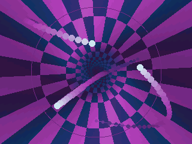
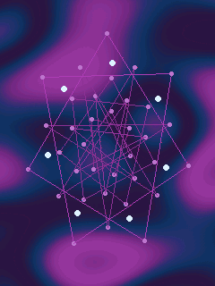
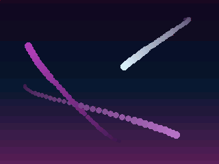
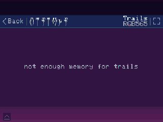

# Physical display controller readbacks

Source `174a79670d4b0da656ebd615f0cd1620aa0ddbb1`, approved CYD image `a980f7e2b9409686ae2d325ebeddfd525966f06e8ded03b2d8a723b36771ab11`. These RGB565 controller snapshots were captured **outside** measurement windows. They are not optical contact-to-photon measurements. Exact commands, UTC, raw hashes and owner action are in [manifest.json](manifest.json); raw data will be bundled under `physical/readback-scenes/`.

| Fullscreen Gate/Trails | Fullscreen Plasma/Kaleido, portrait |
|---|---|
|  |  |

The owner then selected fullscreen for Trails; the visible effect rendered successfully:

The preceding decorated UI attempts below displayed allocation failures after radio/scene history. They are **failed rendering attempts**, not successful feedback-quality samples or performance measurements. Fresh-boot primary windows had separately rendered the UI variants; this later memory history differs. Fullscreen uses a bounded geometric path and releases pixel history, so its success does not establish equivalent full-history rendering with reduced UI cost.

| UI RGB444: allocation failure | UI RGB565: allocation failure |
|---|---|
|  |  |
